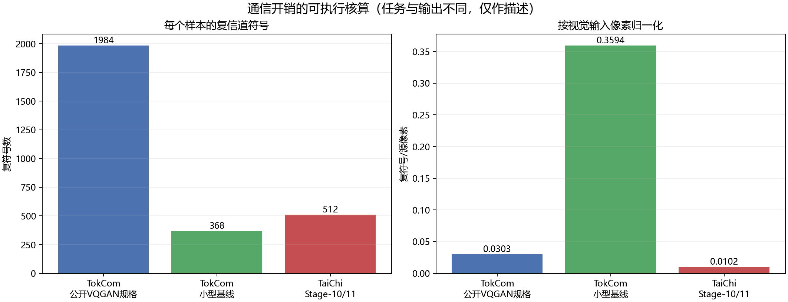

# TokCom 与 TaiChi 的统一通信开销核算

## 为什么分开报告三种单位

离散VQ token的源码率、加入CRC/FEC后的编码比特数、以及连续语义向量占用的复信道符号是不同量。连续语义向量没有指定量化器和熵编码时，不存在可验证的“比特数”，因此本报告不把TaiChi的512个复符号换算成任意bpp。

| 配置 | 任务 | 源表示 | 源码率 | 分包 | 编码比特 | 复信道符号 | 每源像素复符号 |
|---|---|---:|---:|---:|---:|---:|---:|
| 公开VQGAN规格 + 当前TokCom数字链路 | 图像重建 | 256×10=2560 bit | 0.039062 bpp | 64×最多4 token | 7936 | 1984 | 0.030273 |
| 小型TokCom基线 | 32×32图像重建 | 64×6=384 bit | 0.375000 bpp | 16×最多4 token | 1472 | 368 | 0.359375 |
| Stage-10/11 TaiChi | Imagenette问答 | 16×64=1024个实数 | 未定义 | 连续语义信道 | 未定义 | 512 | 0.010204 |

## TokCom数字链路的精确边界

公开VQGAN规格使用256个、1024码本的离散token，源码率为256×10/256²=0.039062 bpp。当前参考链路每4个token形成一个40 bit载荷，逐包加入16 bit CRC与6个卷积码终止位，再用码率1/2卷积码和16-QAM发送。因此每包产生124个编码比特和31个复符号，64包共7936个编码比特和1984个复符号。包含CRC与终止位后的编码比特/源码比特为3.1000。

此数字不包含包头、交织器描述、同步、导频、信道估计或重传。它是当前`digital_link.py`的可执行参考配置，不代表论文未披露的全部物理层细节。测试会把解析计算结果与无噪声链路实际统计逐项比较。

## TaiChi语义信道的精确边界

Stage-10/11模型发送16个视觉token，每个token由896维LLM空间压缩成64个实数。`Channel`把相邻两个实数配成一个I/Q复符号，因此每张图占用16×64/2=512个复信道符号。归一化到224×224视觉输入为0.010204个复符号/像素。

该计数不包含问题文本的传输、同步、导频、信道估计、模型分发和计算成本。连续值没有量化与数字链路，因此不能报告编码比特或bpp。

## 公平解释

当前参考配置下，TokCom数字链路的复符号数是TaiChi视觉语义信道的3.875倍。这个比例只能描述本工程的信道使用量，不能证明TaiChi更高效：TokCom输出重建图像，而Stage-10/11 TaiChi只回答十分类问题。论文级公平对比还需要统一任务、质量指标、信道模型、文本/侧信息开销和目标输出。
