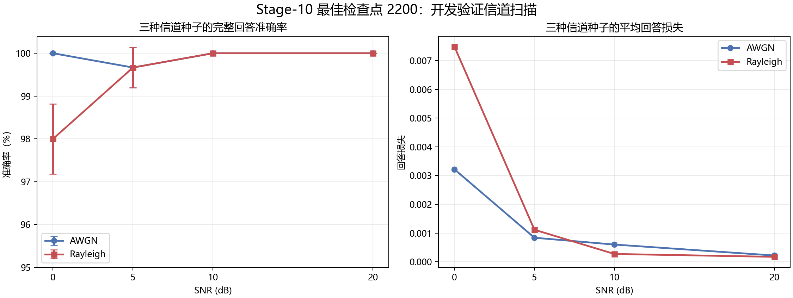

# Stage-10 开发验证信道鲁棒性

使用第2200步最佳模型，在固定100张十类别均衡开发验证图上扫描AWGN与Rayleigh信道。每个SNR使用三个固定信道随机种子101、202、303。

| 信道 | SNR | 准确率均值 | 标准差 | 平均损失 | 种子数 |
|---|---:|---:|---:|---:|---:|
| AWGN | 0 dB | 100.00% | 0.00% | 0.003217 | 3 |
| AWGN | 5 dB | 99.67% | 0.47% | 0.000837 | 3 |
| AWGN | 10 dB | 100.00% | 0.00% | 0.000599 | 3 |
| AWGN | 20 dB | 100.00% | 0.00% | 0.000218 | 3 |
| RAYLEIGH | 0 dB | 98.00% | 0.82% | 0.007487 | 3 |
| RAYLEIGH | 5 dB | 99.67% | 0.47% | 0.001115 | 3 |
| RAYLEIGH | 10 dB | 100.00% | 0.00% | 0.000272 | 3 |
| RAYLEIGH | 20 dB | 100.00% | 0.00% | 0.000172 | 3 |

## 解释边界

这些是开发验证结果，不是最终盲测。模型在AWGN随机SNR训练下获得高鲁棒性；Rayleigh没有作为本阶段主训练信道，因此0 dB下降到98%更能反映分布变化。视觉主干使用ImageNet预训练，而Imagenette属于ImageNet子集，结果包含预训练迁移优势。三种信道种子只能提供初步波动估计，不能替代大样本置信区间。
