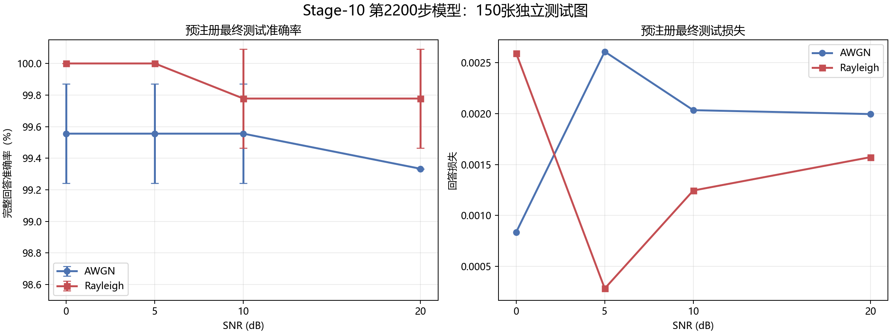
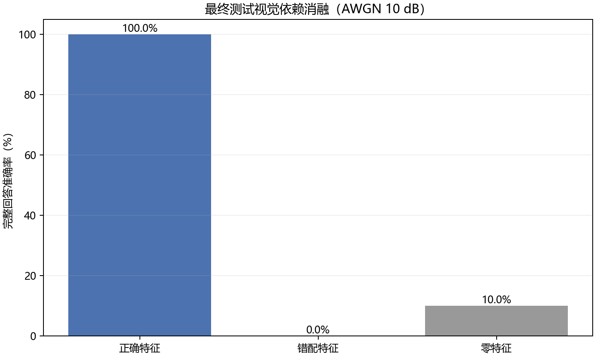
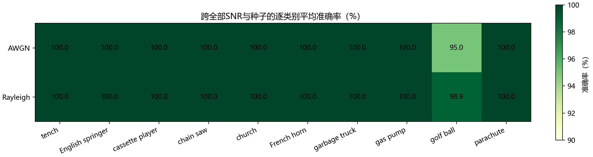

# Stage-10 预注册最终测试报告

## 协议与数据隔离

本报告严格使用提交在测试开启前的`STAGE10_FINAL_TEST_PROTOCOL.json`。协议SHA-256为`11c66a46c0b3ba62f328c3d6509d11746c02d282927434fbbccec66634802de7`；冻结模型为第2200步，测试集150张、每类15张。测试集已用于最终评价，但`used_for_training=false`，所有预注册条件均需完整报告，结果不得用于继续调参或更换模型。

## 信道结果

| 信道 | SNR | 准确率均值 | 总体标准差 | 平均损失 | 种子数 |
|---|---|---|---|---|---|
| AWGN | 0 dB | 99.56% | 0.31% | 0.000836 | 3 |
| AWGN | 5 dB | 99.56% | 0.31% | 0.002609 | 3 |
| AWGN | 10 dB | 99.56% | 0.31% | 0.002034 | 3 |
| AWGN | 20 dB | 99.33% | 0.00% | 0.001995 | 3 |
| RAYLEIGH | 0 dB | 100.00% | 0.00% | 0.002593 | 3 |
| RAYLEIGH | 5 dB | 100.00% | 0.00% | 0.000283 | 3 |
| RAYLEIGH | 10 dB | 99.78% | 0.31% | 0.001245 | 3 |
| RAYLEIGH | 20 dB | 99.78% | 0.31% | 0.001572 | 3 |

## 视觉消融

| 条件 | 损失 | 完整回答准确率 | 图像数 |
|---|---|---|---|
| 正确特征 | 0.002891 | 100.00% | 150 |
| 错配特征 | 6.624247 | 0.00% | 150 |
| 零特征 | 3.041194 | 10.00% | 150 |

## 逐类别稳定性

跨条件错误主要集中在`golf ball`类别；其他类别在大多数条件下保持100%。这说明独立测试没有完全复制开发集的满分结果，同时仍保持很高的整体准确率。

## 结论边界

这是对当前独立实现的预注册测试，不是作者原始模型的精确回放。视觉主干使用ImageNet预训练，而Imagenette是ImageNet子集，因此结果包含预训练分布重叠优势。样本规模仅150张，每个信道条件三个种子；总体标准差描述信道种子波动，不是数据集抽样置信区间。测试集已经开启，后续任何新训练都必须使用新的留出集，不能再把本测试集用于模型选择。
