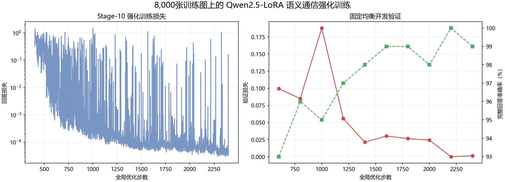
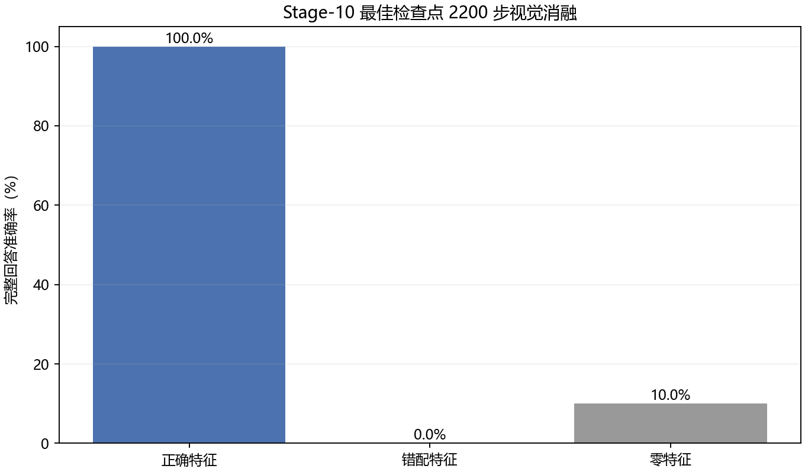

# Stage-10：8,000张图的Qwen双视觉语义通信强化训练

## 配置

训练从Stage-9第400步权重开始，在8,000张十类均衡Imagenette训练图上继续到第2,400步。微批2、梯度累积4，有效批量8。模型共496,264,896个参数，其中2,232,128个可训练。测试集保持封存。

## 固定开发验证

| 步数 | 验证损失 | 完整回答准确率 | 图像数 |
|---|---|---|---|
| 600 | 0.099512 | 93.00% | 100 |
| 800 | 0.085031 | 96.00% | 100 |
| 1000 | 0.187978 | 95.00% | 100 |
| 1200 | 0.055911 | 97.00% | 100 |
| 1400 | 0.021232 | 98.00% | 100 |
| 1600 | 0.030320 | 99.00% | 100 |
| 1800 | 0.026525 | 99.00% | 100 |
| 2000 | 0.024287 | 98.00% | 100 |
| 2200 | 0.000164 | 100.00% | 100 |
| 2400 | 0.001343 | 99.00% | 100 |

## 最佳模型视觉消融

| 条件 | 损失 | 完整回答准确率 | 图像数 |
|---|---|---|---|
| 正确特征 | 0.000127 | 100.00% | 100 |
| 错配特征 | 6.849182 | 0.00% | 100 |
| 零特征 | 3.046525 | 10.00% | 100 |

## 解释边界

这些结果来自参与模型选择的开发验证子集，不是最终盲测。ViT-B/16与ConvNeXt-Tiny来自ImageNet预训练，而Imagenette是ImageNet子集，因此不能宣称视觉主干从未见过相同分布。当前实现是对论文结构的独立近似复现，不是作者训练状态的精确回放；最终测试集仅在模型、信道条件和评价协议冻结后开启。
