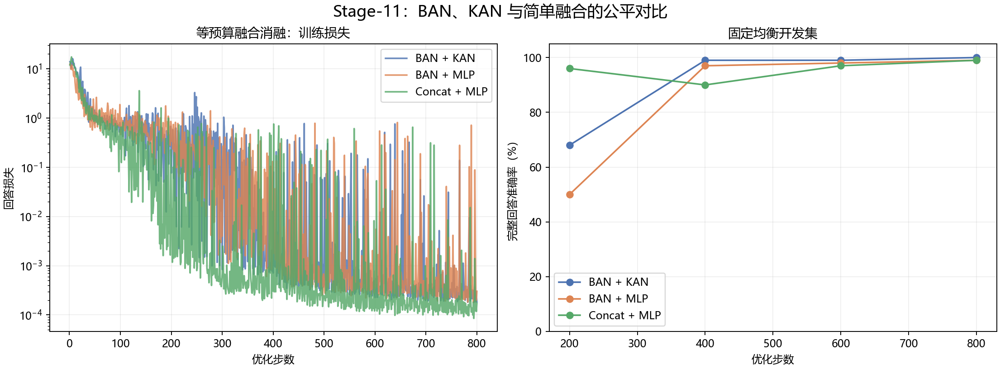
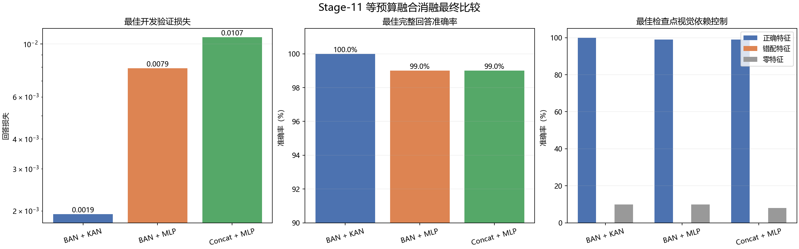

# Stage-11：双视觉融合模块的等预算消融

## 实验问题

本阶段检验论文近似结构中的 BAN 和 KAN 是否在相同数据、随机种子、优化器、LoRA 配置、语义信道维度和 800 步训练预算下带来可测收益。比较 BAN+KAN、BAN+MLP、Concat+MLP 三种融合器。所有模型选择只使用固定的 100 张十类均衡开发图像。

## 主要结果

| 结构 | 最佳步数 | 最佳验证损失 | 完整回答准确率 | 可训练参数 | 训练耗时 |
|---|---|---|---|---|---|
| BAN + KAN | 800 | 0.001940 | 100.00% | 2,232,128 | 0.61 h |
| BAN + MLP | 800 | 0.007914 | 99.00% | 2,150,400 | 0.61 h |
| Concat + MLP | 800 | 0.010666 | 99.00% | 2,125,504 | 0.34 h |

按预先冻结的“最低验证损失，其次最高完整回答准确率”规则，胜出结构为**BAN + KAN**：第800步验证损失0.001940、准确率100.00%。相较BAN+MLP，它增加81,728个可训练参数；相较Concat+MLP增加106,624个。

## 视觉依赖控制

| 结构 | 正确视觉特征 | 错配类别特征 | 零视觉特征 |
|---|---|---|---|
| BAN + KAN | 100.00% | 0.00% | 10.00% |
| BAN + MLP | 99.00% | 0.00% | 10.00% |
| Concat + MLP | 99.00% | 0.00% | 8.00% |

正确特征高、错配特征与零特征低，才能说明回答依赖视觉输入，而不是只由问题模板或语言先验决定。具体预测和目标保留在各运行目录的 `results.json` 中。

## 恢复轨迹审计

| 结构 | 原始日志行 | 唯一训练步 | 重算行 | 重算损失最大差异 | 结论 |
|---|---|---|---|---|---|
| BAN + KAN | 805 | 800 | 5 | 0.0 | 通过 |
| BAN + MLP | 857 | 800 | 57 | 0.0 | 通过 |
| Concat + MLP | 800 | 800 | 0 | 0.0 | 通过 |

BAN+KAN和BAN+MLP在任务计划恢复时重算了最近检查点之后的少量步骤；所有重算步损失逐值一致，验证点没有重复，去重后均完整覆盖1–800。Concat+MLP没有重复步骤。详细机器可读证据见`STAGE11_RECOVERY_AUDIT.json`。

## 结论边界

Stage-11 是开发集消融，不能当成新的盲测结果。三种结构只运行一个训练随机种子，且开发集只有100张图；1个百分点的准确率差异不足以单独支持统计显著性结论。较低验证损失支持在当前配置下选择BAN+KAN，但不能证明BAN或KAN在其他任务、数据和信道中必然更优。Stage-10最终测试集已被消费，本阶段没有再次读取它，也不使用它选择结构。视觉编码器使用ImageNet预训练权重，Imagenette属于ImageNet子集，因此这些结果不能支持“视觉主干从未见过同分布数据”的说法。实现是论文结构的独立近似复现，不是作者权重或私有训练流程的精确回放。
