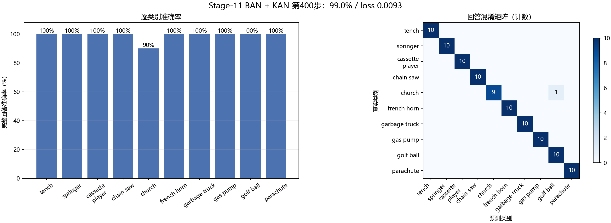

# Stage-11 四小时推进快照

- 生成时间：2026-10-05T12:50:41+08:00
- 协议：`STAGE11_ABLATION_PROTOCOL.json`
- 数据边界：仅使用训练集与固定开发验证集；Stage-10 最终测试集不参与结构选择。

| 结构 | 状态 | 步数 | 最近训练损失 | 当前最佳验证损失 | 当前最佳准确率 |
|---|---|---|---|---|---|
| BAN + KAN | 训练中 | 428/800 | 0.360941 | 0.009316 | 99.00% |
| BAN + MLP | 等待自动接力 | 0/800 | — | — | — |
| Concat + MLP | 等待自动接力 | 0/800 | — | — | — |

下一动作：继续 BAN + KAN 至第 800 步；每 200 步固定开发验证。

该快照是运行状态证据。只有 `status.json` 中 `completed=true` 才计为该结构完成；训练中间结果不用于提前改变冻结预算。

## 最近一次固定开发验证

结构：BAN + KAN；步数：400；损失：0.009316；完整回答准确率：99.00%。

| 类别 | 正确 | 样本 | 准确率 |
|---|---|---|---|
| tench | 10 | 10 | 100.0% |
| english springer | 10 | 10 | 100.0% |
| cassette player | 10 | 10 | 100.0% |
| chain saw | 10 | 10 | 100.0% |
| church | 9 | 10 | 90.0% |
| french horn | 10 | 10 | 100.0% |
| garbage truck | 10 | 10 | 100.0% |
| gas pump | 10 | 10 | 100.0% |
| golf ball | 10 | 10 | 100.0% |
| parachute | 10 | 10 | 100.0% |

