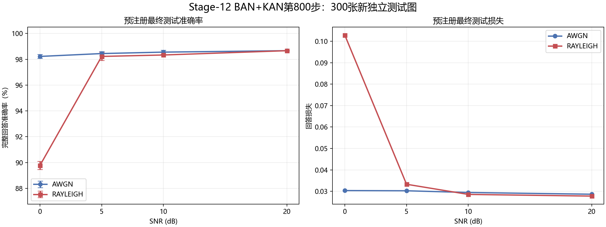
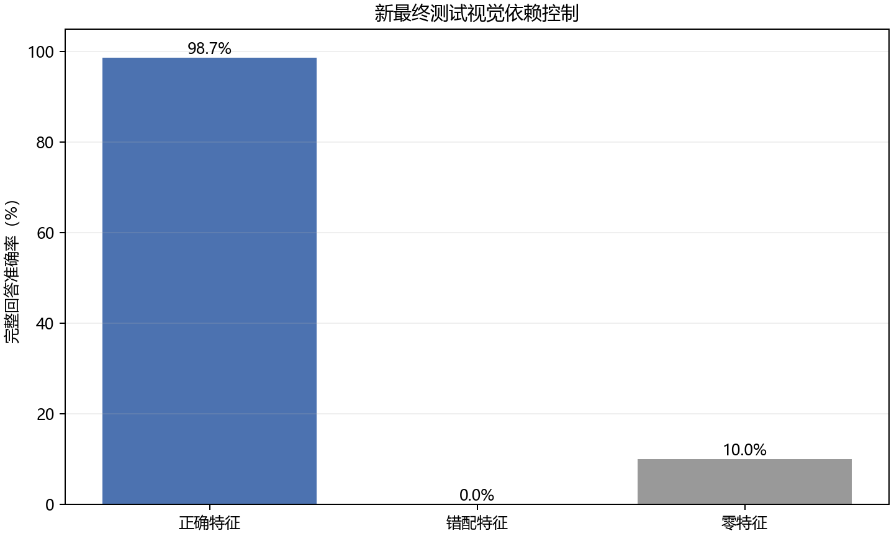
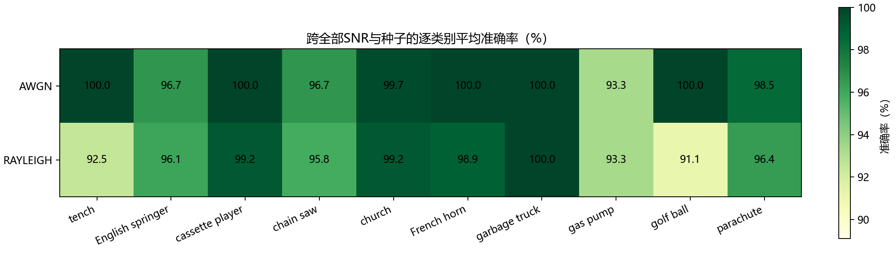

# Stage-12 新留出集预注册最终测试报告

## 协议与隔离

本报告严格使用测试数据打开前提交的`STAGE12_FINAL_TEST_PROTOCOL.json`，协议SHA-256为`7b9f05b85096555f94a5158cece18d1649dfb4d57dd025b0078d9c074ff970c1`。冻结结构为BAN+KAN，检查点第800步、SHA-256为`c41dbb7ff24616ff8d1d2fe387714b2265e7968aa6ebbec39d0948b40dd6831e`。新留出集共300张、每类30张；它排除了所有历史训练、验证和测试清单中的文件哈希与解码像素哈希。该数据已用于最终评价，但`used_for_training=false`，结果不得用于继续训练、调参或更换模型。

## 信道结果

| 信道 | SNR | 准确率均值 | 种子标准差 | 平均损失 | 种子数 |
|---|---|---|---|---|---|
| AWGN | 0 dB | 98.22% | 0.16% | 0.030353 | 3 |
| AWGN | 5 dB | 98.44% | 0.16% | 0.030255 | 3 |
| AWGN | 10 dB | 98.56% | 0.16% | 0.029457 | 3 |
| AWGN | 20 dB | 98.67% | 0.00% | 0.028646 | 3 |
| RAYLEIGH | 0 dB | 89.78% | 0.31% | 0.102893 | 3 |
| RAYLEIGH | 5 dB | 98.22% | 0.31% | 0.033298 | 3 |
| RAYLEIGH | 10 dB | 98.33% | 0.00% | 0.028559 | 3 |
| RAYLEIGH | 20 dB | 98.67% | 0.00% | 0.027776 | 3 |

## 视觉依赖控制

| 条件 | 损失 | 完整回答准确率 | 图像数 |
|---|---|---|---|
| 正确特征 | 0.028344 | 98.67% | 300 |
| 错配特征 | 5.558945 | 0.00% | 300 |
| 零特征 | 2.617466 | 10.00% | 300 |

## 逐类别稳定性

全部预注册正确特征条件中共有50张不同图片至少出现一次错误。逐条件错误索引保存在`runs/stage12_final_test/results.jsonl`，便于审计，但不得据此调整模型。

## 结论边界

这是当前独立实现的第二个预注册测试，不是作者模型的精确回放。视觉主干使用ImageNet预训练，而Imagenette是ImageNet子集，结果包含预训练分布重叠优势。每个信道条件使用3个随机种子；标准差描述信道随机性，不是数据抽样置信区间。新留出集现已消费，后续方法变化必须另建留出集。
