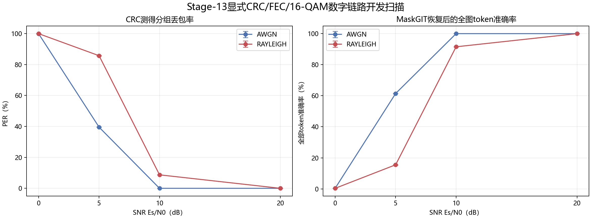

# Stage-13 TokCom显式数字物理层开发报告

本报告使用Stage-13按冻结开发规则选择的最佳ContextMaskGIT检查点，在同一150张开发验证图上评价。协议SHA-256为`1757c29b3654fbc6af99ba2b60266fb8f3a6ddeb1777682875454c69cb4c2a49`。由于该开发集也参与模型选择，结果只用于工程诊断，不是新的盲测或泛化估计；任何方法变化后的最终结论仍需另建留出集。

物理链路逐包执行10-bit token打包、CRC-16/CCITT-FALSE、K=7 `(171,133)` 八进制码率1/2卷积码、六个零终止位、单位平均能量Gray 16-QAM和软输入终止Viterbi。SNR定义为Es/N0；Rayleigh为逐复符号独立衰落并假设接收端完美CSI。这些是公开、可执行的参考配置，不是论文未披露物理层参数的精确复原。

| 信道 | SNR | 实测PER | 载荷BER | 恢复后全token准确率 | MaskGIT丢失位恢复率 | 空间填补恢复率 | 未检出错误token |
|---|---|---|---|---|---|---|---|
| AWGN | 0 dB | 99.93% | 43.866% | 0.432% | 0.360% | 0.069% | 0 |
| AWGN | 5 dB | 39.54% | 9.255% | 61.438% | 2.470% | 2.053% | 0 |
| AWGN | 10 dB | 0.00% | 0.000% | 100.000% | — | — | 0 |
| AWGN | 20 dB | 0.00% | 0.000% | 100.000% | — | — | 0 |
| RAYLEIGH | 0 dB | 99.98% | 45.064% | 0.383% | 0.366% | 0.049% | 0 |
| RAYLEIGH | 5 dB | 85.73% | 24.711% | 15.535% | 1.474% | 1.466% | 0 |
| RAYLEIGH | 10 dB | 8.72% | 0.930% | 91.527% | 2.816% | 1.862% | 0 |
| RAYLEIGH | 20 dB | 0.00% | 0.000% | 99.997% | 0.000% | 0.000% | 0 |

每张图有256个源码token、每token 10 bit，共2,560源码bit。每4个token形成40-bit载荷；加入16-bit CRC、6个终止位和码率1/2卷积码后，每包124编码bit、31个16-QAM复符号，64包共7,936编码bit和1,984个复符号。交织器与包头开销未计入。

接收端只依据解码bit和CRC决定收到或擦除，不使用发送端token修补。CRC未检出的错误会作为错误token保留，因此报告同时给出只在擦除位置计算的恢复率，以及把未检出错误也计入的全token准确率。
