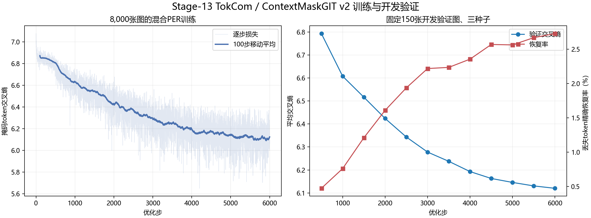
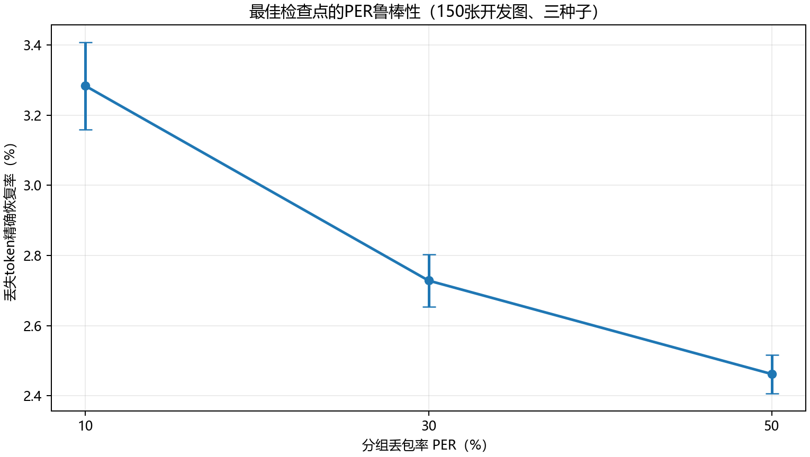
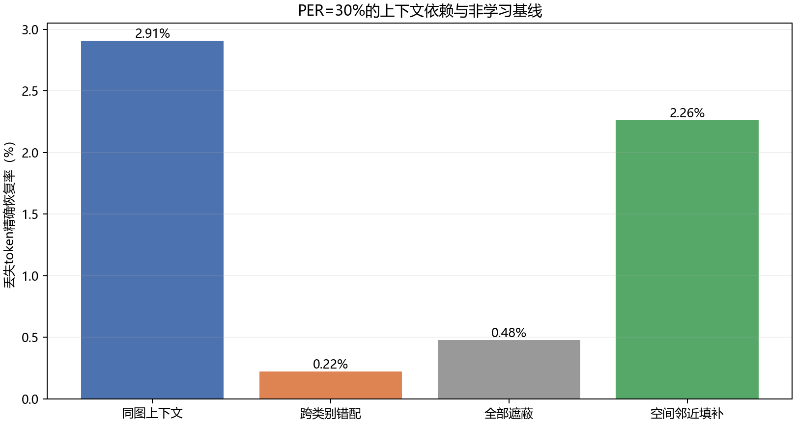

# Stage-13：TokCom大数据ContextMaskGIT开发训练报告

## 范围与协议

本阶段沿第一篇TokCom论文的离散图像token路线推进。公开VQGAN把256×256图像转换为16×16、共256个离散token，码本大小1024；接收端采用本工程的ContextMaskGIT v2，通过二维位置嵌入、局部卷积块和全局Transformer恢复分组丢失token。它不输入类别、答案或其他CMI。

训练协议在运行前冻结，SHA-256为`21b813d5655b0186863291ab5ea74a87a6a2283e2eff134cfed170f114fdc3c7`。训练使用8000张图、150张固定开发验证图、6000步、batch 16，在PER=[0.1, 0.3, 0.5]之间随机采样。最佳检查点按三种固定种子下的平均掩码token交叉熵选择。测试集未读取，`test_accessed=false`、`used_for_training=false`。

## 训练与模型选择

最佳检查点为第**6000**步，平均验证交叉熵为**6.120058**，丢失token精确恢复率为**2.728%**。

## PER扫描

| PER | 恢复率均值 | 种子标准差 | 平均交叉熵 | 种子数 |
|---|---|---|---|---|
| 10% | 3.283% | 0.125% | 6.073315 | 3 |
| 30% | 2.728% | 0.074% | 6.120058 | 3 |
| 50% | 2.462% | 0.055% | 6.192289 | 3 |

## 上下文控制与空间基线

| 输入条件 | 恢复率 | 掩码交叉熵 | 丢失token数 |
|---|---|---|---|
| 同图上下文 | 2.907% | 6.107045 | 11284 |
| 跨类别错配 | 0.222% | 7.360019 | 11284 |
| 全部遮蔽 | 0.479% | 7.132914 | 11284 |
| 空间邻近填补 | 2.260% | — | 11284 |

Stage-7使用1,000张训练图和2,000步时，开发验证集同图上下文恢复率为0.947%，空间邻近填补为2.014%。本阶段扩大到8,000张和6,000步，二者的变化用于衡量扩充数据和混合PER课程是否改善泛化；由于训练种子、采样课程和预算同时变化，这不是单变量因果消融。

## 复现边界

本阶段使用与公开MaskGIT VQGAN匹配的离散码本和图像token规格，但接收端Transformer由本工程从随机参数训练，不是TokCom作者或Google原始预训练MaskGIT权重。Imagenette来自ImageNet，公开VQGAN也使用ImageNet预训练。指标只衡量丢失位置的token精确恢复和交叉熵，尚未加入论文中的CLIP、LPIPS、TCE、重传策略或跨模态上下文。因此这是可验证的近似实现，不是论文数值的精确回放。
