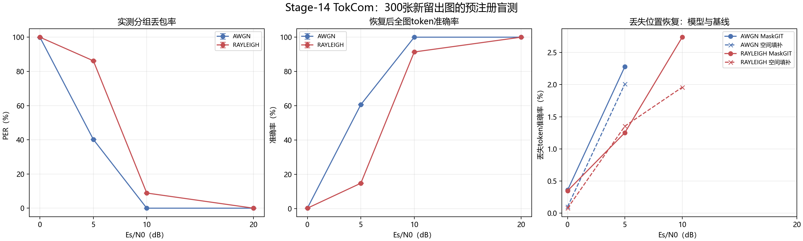

# Stage-14 TokCom预注册盲测报告

本报告在打开新留出集前冻结最佳Stage-13检查点、实现文件哈希、数据选择规则、24个信道条件和全部指标。测试集含300张公开Imagenette图像，每类30张；它与所有既有训练、开发、历史测试及Stage-12留出图在文件哈希和解码像素哈希上零重叠。协议SHA-256为`c4f785b081984abad7c1a9b99b990f9d688b4f480fd64fe92bbddf69bbaf2e63`，检查点SHA-256为`f8b8c0ab73177b048d6bb33522b257d07e8c6c48cecfc092d8a183e1152bd919`。

| 信道 | Es/N0 | 实测PER | 载荷BER | 全图token准确率 | MaskGIT丢失位恢复率 | 空间填补恢复率 | 未检出错误token |
|---|---|---|---|---|---|---|---|
| AWGN | 0 dB | 99.91% | 43.772% | 0.445% | 0.358% | 0.099% | 4 |
| AWGN | 5 dB | 40.20% | 9.375% | 60.717% | 2.281% | 2.011% | 0 |
| AWGN | 10 dB | 0.00% | 0.000% | 100.000% | — | — | 0 |
| AWGN | 20 dB | 0.00% | 0.000% | 100.000% | — | — | 0 |
| RAYLEIGH | 0 dB | 99.98% | 45.149% | 0.358% | 0.348% | 0.077% | 12 |
| RAYLEIGH | 5 dB | 86.18% | 24.874% | 14.894% | 1.252% | 1.354% | 3 |
| RAYLEIGH | 10 dB | 8.86% | 0.972% | 91.387% | 2.738% | 1.959% | 0 |
| RAYLEIGH | 20 dB | 0.00% | 0.000% | 100.000% | — | — | 0 |

每个点使用同一300张图和三个独立信道种子；标准差反映信道随机性，不代表900张独立图。链路为每token 10 bit、每包4 token、CRC-16、K=7 `(171,133)` 码率1/2卷积码、六零终止、Gray 16-QAM和软Viterbi；Rayleigh假设逐符号独立衰落及完美接收端CSI。

这是本工程ContextMaskGIT接收端的盲测。它仍是对TokCom论文的近似实现：使用公开ImageNet VQGAN，但恢复Transformer由本工程训练；没有作者MaskGIT权重、跨模态CMI、重传/TCE、包头/同步/导频开销，也没有CLIP、LPIPS或人类语义质量指标。`test_accessed=true`仅表示按冻结协议完成最终评价，`used_for_training=false`。
