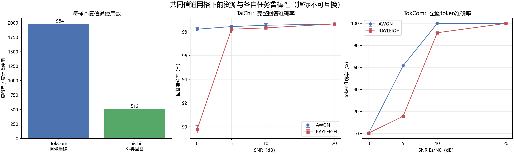

# TokCom 与 TaiChi/TokenCom 公平口径比较

## 可比较内容

两条路线统一使用AWGN/Rayleigh和0、5、10、20 dB Es/N0网格，每个条件三个随机种子；两者都把复符号归一化到单位平均能量，并假设接收端已知Rayleigh信道。通信资源统一换算为复信道使用数：TokCom参考数字链路每张256×256图使用1984个16-QAM复符号；TaiChi连续语义信道每次图像/问题推理发送1024个实值，即512个复信道使用。TokCom/TaiChi比值为3.875。

## 同一信道网格下的各自任务指标

| 信道 | SNR | TaiChi完整回答准确率 | TokCom全图token准确率 | TokCom实测PER |
|---|---|---|---|---|
| AWGN | 0 dB | 98.22% | 0.432% | 99.93% |
| AWGN | 5 dB | 98.44% | 61.438% | 39.54% |
| AWGN | 10 dB | 98.56% | 100.000% | 0.00% |
| AWGN | 20 dB | 98.67% | 100.000% | 0.00% |
| RAYLEIGH | 0 dB | 89.78% | 0.383% | 99.98% |
| RAYLEIGH | 5 dB | 98.22% | 15.535% | 85.73% |
| RAYLEIGH | 10 dB | 98.33% | 91.527% | 8.72% |
| RAYLEIGH | 20 dB | 98.67% | 99.997% | 0.00% |

## 不能直接比较的内容

TaiChi当前任务是Imagenette十分类问答，输出一个类别名称；TokCom任务是恢复256个离散图像token并可进一步解码图像。回答准确率和token准确率不是同一效用函数，不能用表中较大数值宣称某条路线更好。Stage-12 TaiChi数值来自300张预注册新留出图；Stage-13 TokCom物理扫描来自参与模型选择的150张开发图，因此数据证据等级也不同。

TokCom的1,984个复符号包含当前逐包CRC、卷积码和16-QAM，但未包含包头、同步、导频、信道估计、交织器信令和重传。TaiChi的512个复信道使用来自连续值I/Q配对，没有量化、熵编码、数字调制或FEC，且未计问题文本传输。因此3.875倍只能描述本工程当前参考配置的信道使用数，不能解释为端到端频谱效率比。

更严格的论文级公平实验仍需统一输入分辨率、任务输出、效用指标、信道估计开销、延迟、计算量和目标质量。可行方向是在同一图像集合上让两条路线都执行分类，或都执行图像/语义重建，并按相同复信道使用预算重新训练。
