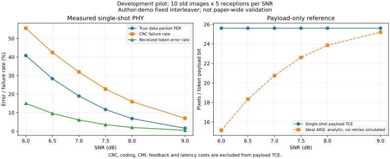

# TokCom 阶段56：多 SNR 固定计划续跑

记录时间：2026-11-25T05:56:35.821983+00:00（UTC；本地 Asia/Shanghai）。本轮从物理 300/300、模型 45/300 组继续。

## 实际增量与覆盖

本轮新增物理 0 组、四路径配对恢复与指标 27 组；当前累计物理 300/300、模型 72/300。保存组全部通过输入哈希、最终 token、未掩码位置保持与有限指标检查。四路径为直接解码、无 CMI、有 CMI、正确 token 理想参考。

| SNR/dB | 物理接收/50 | 物理图像/10 | 四路径模型结果/50 | 模型图像/10 | 模型质量可汇总 |
|---|---:|---:|---:|---:|---|
| 6 | 50 | 10 | 12 | 3 | 否 |
| 6.5 | 50 | 10 | 12 | 3 | 否 |
| 7 | 50 | 10 | 12 | 3 | 否 |
| 7.5 | 50 | 10 | 12 | 3 | 否 |
| 8 | 50 | 10 | 12 | 3 | 否 |
| 9 | 50 | 10 | 12 | 3 | 否 |

模型每个 SNR 需 10 图 × 5 次接收完整后才汇总质量；先对每图五次接收平均，再平均十图。当前完整模型组 0/6；未完成组不输出质量均值。物理组和模型组分别判断完整性。

## 完整物理组与解析参考

| SNR/dB | 真值数据包 PER | CRC 失败率 | 接收 token 错误率 | 单次 payload TCE | 理想 ARQ payload TCE（解析） |
|---|---:|---:|---:|---:|---:|
| 6 | 40.812500% | 55.562500% | 15.023438% | 25.600000 | 15.152000 |
| 6.5 | 28.343750% | 42.468750% | 9.570312% | 25.600000 | 18.344000 |
| 7 | 18.968750% | 31.937500% | 6.093750% | 25.600000 | 20.744000 |
| 7.5 | 11.687500% | 22.781250% | 3.515625% | 25.600000 | 22.608000 |
| 8 | 6.812500% | 15.968750% | 2.007812% | 25.600000 | 23.856000 |
| 9 | 1.593750% | 6.968750% | 0.484375% | 25.600000 | 25.192000 |

图中实线物理误差来自完整缓存，理想 ARQ 虚线为解析计算；没有实际重传实验，也没有模型质量曲线。

TCE 单位为 pixels/token payload bit，单次为 65536/2560=25.6。理想 ARQ 使用真值包错误率 PER 的解析公式 25.6×(1−PER)，假设独立几何重试和理想识错；此处未实际运行重传。CRC 失败率与数据包 PER 分开统计，不将二者互换。每帧 payload 2560 bit、CRC 704 bit、卷积编码后 6528 bit、16-QAM 全帧 1632 符号；payload TCE 不计 CRC、编码、CMI、反馈、包头或延迟成本。类别标签直接提供给接收模型，尚未模拟其传输、误码与资源成本。

## CRC 与 payload 错误定位及掩码覆盖

| SNR/dB | 真值错误包/3200 | CRC失败包/3200 | CRC失败但payload正确包 | CRC通过但payload错误包 | oracle掩码内原正确token | CRC掩码内原正确token |
|---|---:|---:|---:|---:|---:|---:|
| 6 | 1306 | 1778 | 472 | 0 | 3301 | 5189 |
| 6.5 | 907 | 1359 | 452 | 0 | 2403 | 4211 |
| 7 | 607 | 1022 | 415 | 0 | 1648 | 3308 |
| 7.5 | 374 | 729 | 355 | 0 | 1046 | 2466 |
| 8 | 218 | 511 | 293 | 0 | 615 | 1787 |
| 9 | 51 | 223 | 172 | 0 | 142 | 830 |

每个 SNR 共 12800 个 token。两列掩码内原正确 token 统计的是生成前可能被替换的位置，不是生成后损坏数量。本试点两条 CMI 路径使用 oracle 掩码；CRC 掩码列仅描述物理接收数据。CRC 失败但 payload 正确的包不能与真值数据错误包等同；观测到零个 CRC 通过但 payload 错误包，也不证明总体漏检概率为零。

该试点使用旧十张开发图、作者演示固定交织、AWGN/CRC11/卷积码软 Viterbi/16-QAM。同一图与接收序号跨 SNR 重置相同噪声种子。CMI 两路径共享发送端真值 oracle 掩码，分别 w=0、w=1，生成参数、种子及执行锁保持不变。oracle 需要发送端真值，理想正确 token 解码也不是实际 ARQ 接收结果。

本节完整物理统计与多 SNR 恢复均沿用演示输入约定；输入范围和 token 先验诊断使用独立缓存，不替换这些结果。

## 主实验与复现范围

冻结 8 dB 主实验维持 100 图 × 5 次接收、六路径，恢复与指标均为 500/500；本轮新增主实验组数为零。协议、完整汇总及两个执行脚本均匹配原冻结身份。

- 主协议 SHA-256：`e71782b05620880888cdf898cfeab3ceb2cca6878f88dc76f4afe9327c698cc1`。
- 主汇总 SHA-256：`c1590aef6aec5e4257a46ed79174dc8ce0f11b21d2bf7ee314a0804053d96979`。
- 多 SNR 开发计划 SHA-256：`232175f2623e815eef69313a59d4c08d45bc3ef532a00ebe4d45cb75a8f3ca56`。

实际残余 TER 由最终 token ID 与发送 token 比较；作者 TER_af 返回值不作为残余 TER。图像指标沿用原始输出 PSNR、clamp 后 normalize=True 的 LPIPS、clamp→PIL→官方预处理的 CLIP。项目图像去重不证明与公开预训练数据独立。旧开发集结果、固定交织和解析参考不构成整篇论文复现；更大样本 CMI、资源等价基线及论文设置对齐仍未完成。

## 作者训练与演示预处理差异

本轮对固定作者提交的四个文件完成 AST/文本及 GitHub 整文件 blob 身份核对。[训练代码 Trainer/vit.py 第183行](https://github.com/liqiao19/TokenCom_Code/blob/0422ed32dcde3347e0bb6697f343f7a9ff7b3214/Trainer/vit.py#L183) 在编码前执行 2×x−1，把 [0,1] 输入映射到 [-1,1]；[演示 notebook](https://github.com/liqiao19/TokenCom_Code/blob/0422ed32dcde3347e0bb6697f343f7a9ff7b3214/TokCom_Demo.ipynb) 的第8、14个单元则经 Resize/ToTensor 后直接编码 [0,1]。这确认了发布代码路径的差异，尚未证明公开权重实际使用哪套训练流水线，也未证明该差异导致本实验的质量表现。

另有指标口径差异：[作者 LPIPS 包装](https://github.com/liqiao19/TokenCom_Code/blob/0422ed32dcde3347e0bb6697f343f7a9ff7b3214/Performance_metrics.py#L34) 未显式传 normalize 参数，而当前冻结指标显式使用 normalize=True。VQGAN decode_code 直接返回 decoder 输出；本轮没有更改编码输入、输出映射或指标约定。后续需预先定义独立旧开发图 round-trip 对照，固定图像几何和指标，再比较演示输入/原输出与训练范围输入/显式输出映射；不得重写主实验或把口径差异当作已证实因果。

独立对照计划已预先保存为 stage55_range_diagnostic_plan.json：固定十张旧开发图、图像几何和指标，比较输入 x / 2x−1 与输出 y / (y+1)/2 的四种组合，并报告全部条件和 token ID 差异。阶段55仅保存计划，不包含这项模型对照结果；后续是否执行应查看独立执行回执。计划不使用信道或 MaskGIT，不选择最佳条件，不改变当前多 SNR 试点。

## 已执行的输入/输出映射对照

| 编码输入 | 解码输出映射 | PSNR/dB | LPIPS | CLIP |
|---|---|---:|---:|---:|
| x | y | 19.497130 | 0.189839 | 0.820243 |
| x | (y+1)/2 | 9.551932 | 0.351293 | 0.774381 |
| 2x−1 | y | 3.243941 | 0.407226 | 0.718534 |
| 2x−1 | (y+1)/2 | 20.296025 | 0.175737 | 0.835093 |

十张旧开发图、四条件全部齐备，按图像平均。每张图四条件相对演示原输出的配对差值保存在本阶段 session_progress.json，均值与完整审计逐项核对。两种编码共有 2327/2560 个位置的 token ID 不同（90.8984%），这是编码身份差异，不是信道 TER。原始像素与源图逐像素核对，PSNR 从保存输出重算；LPIPS/CLIP 的输入约定及权重受执行锁约束。没有选择或覆盖任何条件，也没有执行信道或 MaskGIT 恢复。

## 固定掩码 token 先验匹配检查

| 编码输入 | 类别条件 | 平均交叉熵/(nat/token) | 掩码位置 top-1 准确率 |
|---|---|---:|---:|
| x | 无 CMI | 4.303385 | 11.6406% |
| x | 有 CMI | 4.191772 | 11.4844% |
| 2x−1 | 无 CMI | 4.499466 | 9.3750% |
| 2x−1 | 有 CMI | 4.429656 | 9.9219% |

本节交叉熵 CE 的单位为 nat/token，与上文通信效率 TCE（pixels/token payload bit）不是同一指标。每图固定随机选择 128/256 个掩码位置，四条件共享位置；十图按图像平均。使用作者完整 1025 类 logits 计算交叉熵，审计从保存 logits 独立重算交叉熵和 top-1 计数。类别模式使用相同真值标签，分别丢弃或保留条件。不同输入编码会改变目标 token 分布，因此跨编码交叉熵与准确率不能单独判定哪种预处理与权重训练更匹配。此处没有迭代生成、物理信道或图像质量评估；其结果不等同信道恢复收益，也不证明公开权重的实际训练流水线。

后续完整链路对照已预先记录在 stage56_end_to_end_convention_plan.json：同十图、8 dB、每图五次接收、相同物理链路和生成参数，比较两套一致的输入/输出约定及全部四路径。只有两套流水线各50组齐备才做跨流水线质量汇总；现有演示缓存仅在全部身份和设置相同时复用。此计划尚未执行，不能把上述诊断当作它的结果。

## 发布与续跑

本报告基于发布前审计；发布提交、远端 CI 和精确 Git tree/commit 验证写入单独本地回执，避免自引用。持续更新草稿 PR：https://github.com/zhoujinyi8/tokencomm/pull/1 。原始图像、权重和逐接收缓存不进入发布白名单。

剩余物理 0 组、模型 228 组。保持原计划和执行锁，通过 cache_stage54_development_phy.py、audit_stage54_development_phy.py、run_stage54_development_multisnr.py、audit_stage54_development_recovery.py 续跑；已保存完整组自动跳过。历史阶段报告不重写，当前会话另存审计快照。
