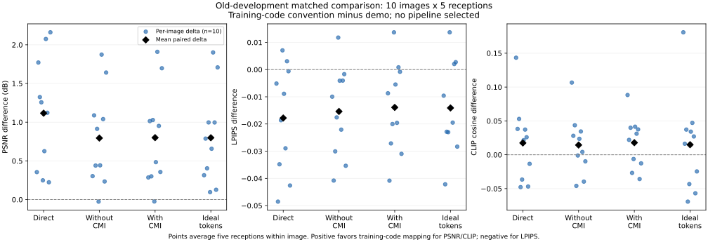

# TokCom 阶段58：完整链路输入约定对照

记录时间：2026-11-25T16:08:41.448526+00:00（UTC；本地 Asia/Shanghai）。执行预先保存的 stage56_end_to_end_convention_plan.json，独立于原冻结研究。

## 当前实际覆盖与本轮增量

| 流水线 | 完整四路径接收组/50 | 复用旧恢复 | 本研究计算 | 图像覆盖/10 |
|---|---:|---:|---:|---:|
| demo | 50 | 12 | 38 | 10 |
| training_code_convention | 50 | 0 | 50 | 10 |

当前共 100/100 个完整流水线接收组，其中复用旧恢复 12 组、本研究计算 88 组。本轮新计算 46 组；同图同次接收的完整配对为 50/50，五次接收均配对齐备的图像为 10/10。每个接收组包含直接解码、无 CMI、有 CMI、正确 token 理想参考四路径。复用与新计算分别记录，不把复用计作新模型推理。

## 两套流水线的完整物理接收

| 流水线 | 物理接收组 | 真值错误包/3200 | 接收错误token/12800 | CRC失败包/3200 |
|---|---:|---:|---:|---:|
| demo | 50 | 218 | 257 | 511 |
| training_code_convention | 50 | 216 | 257 | 480 |

本轮实际新增物理模拟 0 组；演示约定50组来自已审计缓存。两套流水线各10图×5次接收，8 dB、相同图像/接收序号噪声种子、CRC11、[101,111]卷积码软Viterbi、16-QAM及作者演示固定交织。每帧256个10-bit token，payload 2560 bit，CRC 704 bit，编码后6528 bit，全帧1632个QAM符号。不同编码改变发送符号，因而错误包位置可以不同；每套流水线根据自身真值错误包生成oracle掩码，两种类别模式在同套流水线内共享掩码。

## 约定、身份和复用条件

- demo：原图x∈[0,1]直接编码，原始解码输出y参与指标。
- training_code_convention：编码2x−1，全部四路径的解码输出统一映射为(y+1)/2后参与指标。名称来自训练代码写法，不证明公开权重实际训练预处理。
- 两套均固定RGB、Resize((256,256))、相同VQGAN/MaskGIT权重，生成种子20261124、32步、sm_temp=1.3、r_temp=7、linear随机化与arccos调度。w=0/1分别去除/保留同一真值ImageNet类别。类别标签直接提供，未模拟CMI传输与额外资源成本。
- PSNR使用各约定定义的未钳制输出对原图计算；LPIPS采用clamp和normalize=True；CLIP采用clamp→PIL→官方预处理。token正确率始终对该流水线自己的发送ID计算，跨编码ID差异不作信道TER。
- 复用只限冻结来源清单中身份匹配的旧演示结果：计划、生成参数、PHY种子、权重、指标约定、源图、接收文件、恢复数组及原结果行均核对。冻结的复用来源清单允许旧研究以后继续，不改变本对照的执行身份。既有文件均未改写。

## 质量汇总状态

| 流水线 | 路径 | 正确token/256 | PSNR/dB | LPIPS | CLIP |
|---|---|---:|---:|---:|---:|
| demo | direct | 250.860000 | 18.871355 | 0.203795 | 0.815378 |
| demo | without_cmi | 240.960000 | 19.039033 | 0.200729 | 0.814762 |
| demo | with_cmi | 241.140000 | 19.047309 | 0.199192 | 0.818000 |
| demo | ideal_correct_tokens | 256.000000 | 19.497130 | 0.189839 | 0.820243 |
| training_code_convention | direct | 250.860000 | 19.987650 | 0.185991 | 0.832798 |
| training_code_convention | without_cmi | 240.520000 | 19.833965 | 0.185343 | 0.829137 |
| training_code_convention | with_cmi | 240.560000 | 19.847515 | 0.185287 | 0.835847 |
| training_code_convention | ideal_correct_tokens | 256.000000 | 20.296025 | 0.175737 | 0.835093 |

先对每图五次接收平均，再汇总十图；全部逐图配对差值保存在完整审计 JSON，不选择最佳流水线。

| 路径：训练代码约定减演示约定 | 正确token差值 | PSNR差值/dB | LPIPS差值 | CLIP差值 |
|---|---:|---:|---:|---:|
| direct | 0.000000 | 1.116295 | -0.017804 | 0.017420 |
| without_cmi | -0.440000 | 0.794931 | -0.015386 | 0.014374 |
| with_cmi | -0.580000 | 0.800206 | -0.013905 | 0.017847 |
| ideal_correct_tokens | 0.000000 | 0.798895 | -0.014102 | 0.014850 |

每个点是同图五次接收平均后的差值，黑色菱形是十图配对均值。图不表示独立验证或显著性检验；PSNR/CLIP正值与LPIPS负值分别对应训练代码约定下该指标数值方向更优，不能据单指标选择流水线。

汇总入口已通过四项独立检查：完整配对且输入顺序改变时正确汇总、缺少接收拒绝汇总、重复坐标不能掩盖缺项、缺少路径拒绝汇总。实际缓存另经输入哈希、最终ID、未掩码位置保持、有限指标和精确复用核验。

## 既有研究与范围

原多 SNR 研究仍为物理300/300、模型72/300，本轮未改写其缓存或推进其组数；本对照拥有独立缓存和执行锁。100图×5次接收的冻结8 dB主实验仍为恢复与指标500/500。

主协议 SHA-256：`e71782b05620880888cdf898cfeab3ceb2cca6878f88dc76f4afe9327c698cc1`。
主汇总 SHA-256：`c1590aef6aec5e4257a46ed79174dc8ce0f11b21d2bf7ee314a0804053d96979`。
独立对照计划 SHA-256：`f52b00b26b41dc7dea7e674679e526487145e47b9d09f425f28e723913e0fe83`。

本研究沿用十张旧开发图，属于探索性配对对照；固定交织、oracle错误定位、理想正确token参考及完美类别条件不代表整篇论文的实际部署设置。此前无噪重建和固定掩码预测没有给出同一变化方向；本对照已完整测量两套约定的信道恢复链路；结果只描述这十张开发图，不用于选择或改写主实验流水线。原始图像、权重、逐接收数组均不进入Git白名单。

## 权重来源与元数据边界

本轮以安全只读方式核验两份权重SHA-256。VQGAN旧格式只解析四段pickle文件头操作码，未反序列化对象或分配tensor；MaskGIT使用weights_only=True与内存映射读取显式元数据，没有构造网络或运行推理。已读取的元数据没有建立可追溯的训练预处理记录；旧VQGAN检查仅限文件头标记，不能据此断言元数据完全不存在。

两份本地权重均与[提供库固定版本](https://huggingface.co/llvictorll/Maskgit-pytorch/tree/8513f87a4f677564b68e80c561bc3ace7ec142f6)中的对应LFS对象SHA-256一致。提供库revision：`8513f87a4f677564b68e80c561bc3ace7ec142f6`。[上游发布训练实现](https://github.com/valeoai/Halton-MaskGIT/blob/v1.0/Trainer/vit.py#L185)在编码前同样执行2x−1；源文件Git blob：`55e50af28c412fa64189a9be487bd6585304e0e5`。这些证据确认二进制身份与已发布代码写法，仍不证明实际训练运行的全部预处理，也不依据性能结果反推训练口径。

## 发布与续跑

本对照100个流水线接收组与50对接收均完成，四路径质量及逐图配对差值已汇总。后续可继续原六SNR开发研究剩余接收组；保留本对照独立结果与全部执行锁，不依据开发图结果选择新的主实验流水线。发布提交、CI和精确Git树核验另写本地发布回执，避免自引用。草稿PR：https://github.com/zhoujinyi8/tokencomm/pull/1 。
