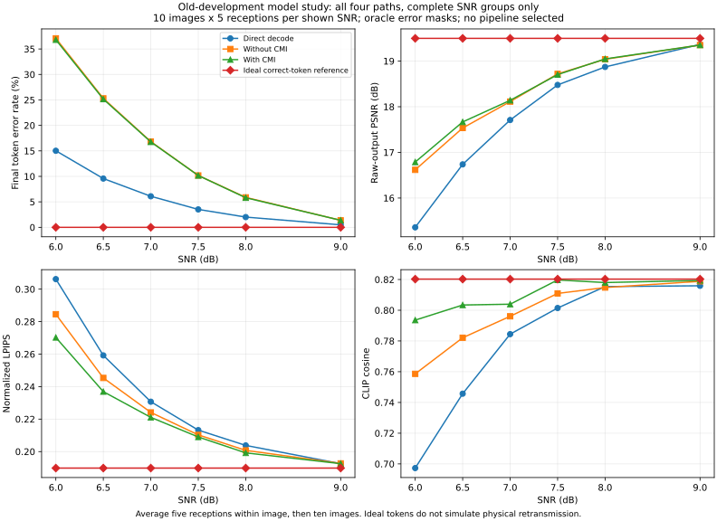
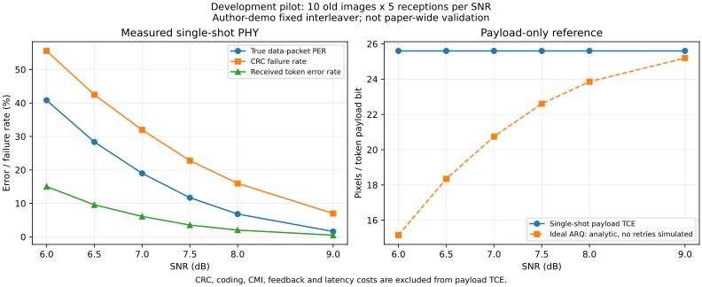

# TokCom 阶段59：多 SNR 固定计划续跑

记录时间：2026-11-25T21:03:13.398790+00:00（UTC；本地 Asia/Shanghai）。本轮从物理 300/300、模型 72/300 组继续。

## 实际增量与覆盖

本轮新增物理 0 组、四路径配对恢复与指标 228 组；当前累计物理 300/300、模型 300/300。保存组全部通过输入哈希、最终 token、未掩码位置保持与有限指标检查。四路径为直接解码、无 CMI、有 CMI、正确 token 理想参考。

本轮另行核对Python版本、七个依赖包版本与十个作者源文件SHA-256，均与冻结环境记录一致；权重、源图和生成身份由实际模型执行入口核验。环境核对本身没有构造模型或运行推理。

| SNR/dB | 物理接收/50 | 物理图像/10 | 四路径模型结果/50 | 模型图像/10 | 模型质量可汇总 |
|---|---:|---:|---:|---:|---|
| 6 | 50 | 10 | 50 | 10 | 是 |
| 6.5 | 50 | 10 | 50 | 10 | 是 |
| 7 | 50 | 10 | 50 | 10 | 是 |
| 7.5 | 50 | 10 | 50 | 10 | 是 |
| 8 | 50 | 10 | 50 | 10 | 是 |
| 9 | 50 | 10 | 50 | 10 | 是 |

模型每个 SNR 需 10 图 × 5 次接收完整后才汇总质量；先对每图五次接收平均，再平均十图。当前完整模型组 6/6；未完成组不输出质量均值。物理组和模型组分别判断完整性。

## 完整模型组的四路径质量

| SNR/dB | 路径 | 正确token/256 | 残余TER | PSNR/dB | LPIPS | CLIP |
|---|---|---:|---:|---:|---:|---:|
| 6 | direct | 217.540000 | 15.023437% | 15.358138 | 0.306193 | 0.697298 |
| 6 | without_cmi | 161.080000 | 37.078125% | 16.617449 | 0.284566 | 0.758608 |
| 6 | with_cmi | 161.780000 | 36.804688% | 16.788092 | 0.270245 | 0.793563 |
| 6 | ideal_correct_tokens | 256.000000 | 0.000000% | 19.497130 | 0.189839 | 0.820243 |
| 6.5 | direct | 231.500000 | 9.570312% | 16.737147 | 0.259220 | 0.745705 |
| 6.5 | without_cmi | 191.220000 | 25.304688% | 17.534004 | 0.245341 | 0.782099 |
| 6.5 | with_cmi | 191.600000 | 25.156250% | 17.666600 | 0.236896 | 0.803394 |
| 6.5 | ideal_correct_tokens | 256.000000 | 0.000000% | 19.497130 | 0.189839 | 0.820243 |
| 7 | direct | 240.400000 | 6.093750% | 17.708821 | 0.230705 | 0.784440 |
| 7 | without_cmi | 212.920000 | 16.828125% | 18.112070 | 0.224113 | 0.796054 |
| 7 | with_cmi | 213.100000 | 16.757813% | 18.140020 | 0.221072 | 0.803917 |
| 7 | ideal_correct_tokens | 256.000000 | 0.000000% | 19.497130 | 0.189839 | 0.820243 |
| 7.5 | direct | 247.000000 | 3.515625% | 18.477437 | 0.213207 | 0.801438 |
| 7.5 | without_cmi | 229.940000 | 10.179688% | 18.719424 | 0.210281 | 0.810927 |
| 7.5 | with_cmi | 229.980000 | 10.164062% | 18.703010 | 0.208980 | 0.819693 |
| 7.5 | ideal_correct_tokens | 256.000000 | 0.000000% | 19.497130 | 0.189839 | 0.820243 |
| 8 | direct | 250.860000 | 2.007812% | 18.871355 | 0.203795 | 0.815378 |
| 8 | without_cmi | 240.960000 | 5.875000% | 19.039033 | 0.200729 | 0.814762 |
| 8 | with_cmi | 241.140000 | 5.804688% | 19.047309 | 0.199192 | 0.818000 |
| 8 | ideal_correct_tokens | 256.000000 | 0.000000% | 19.497130 | 0.189839 | 0.820243 |
| 9 | direct | 254.760000 | 0.484375% | 19.364361 | 0.192547 | 0.815903 |
| 9 | without_cmi | 252.480000 | 1.375000% | 19.350757 | 0.192725 | 0.818831 |
| 9 | with_cmi | 252.480000 | 1.375000% | 19.351310 | 0.192549 | 0.819375 |
| 9 | ideal_correct_tokens | 256.000000 | 0.000000% | 19.497130 | 0.189839 | 0.820243 |

每个显示SNR均为完整50次接收，先对每图五次接收平均，再平均十图。四路径全部保留；token相等与图像质量分别解释，不依据任一指标选择流水线。图中理想正确token参考不是实际重传基线。

## 修复与原正确token改错的分解

| SNR/dB | 恢复模式 | 接收原错误/12800 | 原错修复 | 原正确改错 | 净正确数增量 | 最终错误/12800 |
|---|---|---:|---:|---:|---:|---:|
| 6 | without_cmi | 1923 | 172 | 2995 | -2823 | 4746 |
| 6 | with_cmi | 1923 | 183 | 2971 | -2788 | 4711 |
| 6.5 | without_cmi | 1225 | 126 | 2140 | -2014 | 3239 |
| 6.5 | with_cmi | 1225 | 135 | 2130 | -1995 | 3220 |
| 7 | without_cmi | 780 | 88 | 1462 | -1374 | 2154 |
| 7 | with_cmi | 780 | 101 | 1466 | -1365 | 2145 |
| 7.5 | without_cmi | 450 | 57 | 910 | -853 | 1303 |
| 7.5 | with_cmi | 450 | 57 | 908 | -851 | 1301 |
| 8 | without_cmi | 257 | 35 | 530 | -495 | 752 |
| 8 | with_cmi | 257 | 35 | 521 | -486 | 743 |
| 9 | without_cmi | 62 | 10 | 124 | -114 | 176 |
| 9 | with_cmi | 62 | 9 | 123 | -114 | 176 |

每个SNR均为完整50次接收、12800个token。逐组从保存ID重新分类并严格核对：正确数变化=原错修复−原正确改错；未掩码位置保持不变。JSON记录全部四路径及逐图五次接收均值；直接解码修复与改错均为零，理想正确token参考修复全部原错且不损坏原正确token。这是既有结果的描述性分解，没有据此调整掩码、种子或模型，也没有重新推理。

## 完整物理组与解析参考

| SNR/dB | 真值数据包 PER | CRC 失败率 | 接收 token 错误率 | 单次 payload TCE | 理想 ARQ payload TCE（解析） |
|---|---:|---:|---:|---:|---:|
| 6 | 40.812500% | 55.562500% | 15.023438% | 25.600000 | 15.152000 |
| 6.5 | 28.343750% | 42.468750% | 9.570312% | 25.600000 | 18.344000 |
| 7 | 18.968750% | 31.937500% | 6.093750% | 25.600000 | 20.744000 |
| 7.5 | 11.687500% | 22.781250% | 3.515625% | 25.600000 | 22.608000 |
| 8 | 6.812500% | 15.968750% | 2.007812% | 25.600000 | 23.856000 |
| 9 | 1.593750% | 6.968750% | 0.484375% | 25.600000 | 25.192000 |

图中实线物理误差来自完整缓存，理想 ARQ 虚线为解析计算；没有实际重传实验，也没有模型质量曲线。

TCE 单位为 pixels/token payload bit，单次为 65536/2560=25.6。理想 ARQ 使用真值包错误率 PER 的解析公式 25.6×(1−PER)，假设独立几何重试和理想识错；此处未实际运行重传。CRC 失败率与数据包 PER 分开统计，不将二者互换。每帧 payload 2560 bit、CRC 704 bit、卷积编码后 6528 bit、16-QAM 全帧 1632 符号；payload TCE 不计 CRC、编码、CMI、反馈、包头或延迟成本。类别标签直接提供给接收模型，尚未模拟其传输、误码与资源成本。

## CRC 与 payload 错误定位及掩码覆盖

| SNR/dB | 真值错误包/3200 | CRC失败包/3200 | CRC失败但payload正确包 | CRC通过但payload错误包 | oracle掩码内原正确token | CRC掩码内原正确token |
|---|---:|---:|---:|---:|---:|---:|
| 6 | 1306 | 1778 | 472 | 0 | 3301 | 5189 |
| 6.5 | 907 | 1359 | 452 | 0 | 2403 | 4211 |
| 7 | 607 | 1022 | 415 | 0 | 1648 | 3308 |
| 7.5 | 374 | 729 | 355 | 0 | 1046 | 2466 |
| 8 | 218 | 511 | 293 | 0 | 615 | 1787 |
| 9 | 51 | 223 | 172 | 0 | 142 | 830 |

每个 SNR 共 12800 个 token。两列掩码内原正确 token 统计的是生成前可能被替换的位置，不是生成后损坏数量。本试点两条 CMI 路径使用 oracle 掩码；CRC 掩码列仅描述物理接收数据。CRC 失败但 payload 正确的包不能与真值数据错误包等同；观测到零个 CRC 通过但 payload 错误包，也不证明总体漏检概率为零。

该试点使用旧十张开发图、作者演示固定交织、AWGN/CRC11/卷积码软 Viterbi/16-QAM。同一图与接收序号跨 SNR 重置相同噪声种子。CMI 两路径共享发送端真值 oracle 掩码，分别 w=0、w=1，生成参数、种子及执行锁保持不变。oracle 需要发送端真值，理想正确 token 解码也不是实际 ARQ 接收结果。

本节完整物理统计与多 SNR 恢复均沿用演示输入约定；输入范围和 token 先验诊断使用独立缓存，不替换这些结果。

## 主实验与复现范围

冻结 8 dB 主实验维持 100 图 × 5 次接收、六路径，恢复与指标均为 500/500；本轮新增主实验组数为零。协议、完整汇总及两个执行脚本均匹配原冻结身份。

- 主协议 SHA-256：`e71782b05620880888cdf898cfeab3ceb2cca6878f88dc76f4afe9327c698cc1`。
- 主汇总 SHA-256：`c1590aef6aec5e4257a46ed79174dc8ce0f11b21d2bf7ee314a0804053d96979`。
- 多 SNR 开发计划 SHA-256：`232175f2623e815eef69313a59d4c08d45bc3ef532a00ebe4d45cb75a8f3ca56`。

实际残余 TER 由最终 token ID 与发送 token 比较；作者 TER_af 返回值不作为残余 TER。图像指标沿用原始输出 PSNR、clamp 后 normalize=True 的 LPIPS、clamp→PIL→官方预处理的 CLIP。项目图像去重不证明与公开预训练数据独立。旧开发集结果、固定交织和解析参考不构成整篇论文复现；更大样本 CMI、资源等价基线及论文设置对齐仍未完成。

## 与论文实验范围的剩余差异

[论文VI-A/B](https://arxiv.org/html/2502.12096v5#S6)使用ImageNet100、随机化包内token位置及独立信道完美恢复的7-bit类别标签。本地开发集为十张Imagenette图像，冻结主实验为同来源十类的100张图；100张图不等同ImageNet100数据集。当前采用演示固定交织并直接提供类别条件，没有CMI传输资源实验。论文确切数据子集与划分仍需明确。

本地代码与Sionna源文件核对表明：CRC和卷积编码按包处理，输出每包102个编码bit；16-QAM阶段才把64包编码bit拼接映射为1632个符号。102不是4的整数倍，因此这个全帧符号数不能直接除以64后作为独立包重传的整数符号成本。若另行设计每包补2bit的独立映射，则每包26个符号、64包共1664个符号；这只是算术示例，未采用、未模拟，也不修改原接收或payload TCE结果。

后续实际ARQ须先固定包/符号边界、停止规则、重试噪声与类别资源核算，再实现相同条件的基线；当前理想正确token解码及解析TCE不替代物理重传实验。Cheng约0.04bpp基线仍未完成。

## 作者训练与演示预处理差异

阶段55对固定作者提交的四个文件完成 AST/文本及 GitHub 整文件 blob 身份核对。[训练代码 Trainer/vit.py 第183行](https://github.com/liqiao19/TokenCom_Code/blob/0422ed32dcde3347e0bb6697f343f7a9ff7b3214/Trainer/vit.py#L183) 在编码前执行 2×x−1，把 [0,1] 输入映射到 [-1,1]；[演示 notebook](https://github.com/liqiao19/TokenCom_Code/blob/0422ed32dcde3347e0bb6697f343f7a9ff7b3214/TokCom_Demo.ipynb) 的第8、14个单元则经 Resize/ToTensor 后直接编码 [0,1]。这确认了发布代码路径的差异，尚未证明公开权重实际使用哪套训练流水线，也未证明该差异导致本实验的质量表现。

另有指标口径差异：[作者 LPIPS 包装](https://github.com/liqiao19/TokenCom_Code/blob/0422ed32dcde3347e0bb6697f343f7a9ff7b3214/Performance_metrics.py#L34) 未显式传 normalize 参数，而当前冻结指标显式使用 normalize=True。VQGAN decode_code 直接返回 decoder 输出；本轮没有更改编码输入、输出映射或指标约定。独立旧开发图 round-trip 与链路对照的执行状态见后节；不得重写主实验或把口径差异当作已证实因果。

独立对照计划已预先保存为 stage55_range_diagnostic_plan.json：固定十张旧开发图、图像几何和指标，比较输入 x / 2x−1 与输出 y / (y+1)/2 的四种组合，并报告全部条件和 token ID 差异。阶段55仅保存计划，不包含这项模型对照结果；后续是否执行应查看独立执行回执。计划不使用信道或 MaskGIT，不选择最佳条件，不改变当前多 SNR 试点。

## 已执行的输入/输出映射对照

| 编码输入 | 解码输出映射 | PSNR/dB | LPIPS | CLIP |
|---|---|---:|---:|---:|
| x | y | 19.497130 | 0.189839 | 0.820243 |
| x | (y+1)/2 | 9.551932 | 0.351293 | 0.774381 |
| 2x−1 | y | 3.243941 | 0.407226 | 0.718534 |
| 2x−1 | (y+1)/2 | 20.296025 | 0.175737 | 0.835093 |

十张旧开发图、四条件全部齐备，按图像平均。每张图四条件相对演示原输出的配对差值保存在本阶段 session_progress.json，均值与完整审计逐项核对。两种编码共有 2327/2560 个位置的 token ID 不同（90.8984%），这是编码身份差异，不是信道 TER。原始像素与源图逐像素核对，PSNR 从保存输出重算；LPIPS/CLIP 的输入约定及权重受执行锁约束。没有选择或覆盖任何条件，也没有执行信道或 MaskGIT 恢复。

## 固定掩码 token 先验匹配检查

| 编码输入 | 类别条件 | 平均交叉熵/(nat/token) | 掩码位置 top-1 准确率 |
|---|---|---:|---:|
| x | 无 CMI | 4.303385 | 11.6406% |
| x | 有 CMI | 4.191772 | 11.4844% |
| 2x−1 | 无 CMI | 4.499466 | 9.3750% |
| 2x−1 | 有 CMI | 4.429656 | 9.9219% |

本节交叉熵 CE 的单位为 nat/token，与上文通信效率 TCE（pixels/token payload bit）不是同一指标。每图固定随机选择 128/256 个掩码位置，四条件共享位置；十图按图像平均。使用作者完整 1025 类 logits 计算交叉熵，审计从保存 logits 独立重算交叉熵和 top-1 计数。类别模式使用相同真值标签，分别丢弃或保留条件。不同输入编码会改变目标 token 分布，因此跨编码交叉熵与准确率不能单独判定哪种预处理与权重训练更匹配。此处没有迭代生成、物理信道或图像质量评估；其结果不等同信道恢复收益，也不证明公开权重的实际训练流水线。

## 已完成且保持独立的8 dB链路约定对照

stage56_end_to_end_convention_plan.json 对应的独立对照已在阶段58完成：同十张旧开发图、8 dB、每图五次接收、两套约定各50组，共100个完整四路径接收组、50对接收。本轮重新核验阶段58冻结审计与100个结果文件哈希，没有重算、改写或把这些组转计入原六SNR试点。原六SNR模型覆盖仅按其独立目录的实际结果统计。

完整对照中，训练代码约定相对演示约定的图像指标有变化，但两套约定下恢复后的token正确率均低于直接接收；训练代码约定的恢复PSNR也低于该约定的直接解码。因此没有依据开发图结果选择新的主实验流水线。全部四路径及逐图配对差值保存在阶段58冻结审计，输入映射诊断与固定掩码先验探测均不代替这项链路结果。

## 后续独立随机交织计划（尚未执行）

在当前六SNR质量汇总之前预先保存随机包分配敏感性计划：仍用同十张开发图、六SNR、每图五次接收，计划另算300组物理接收与四路径模型结果。每图使用固定PCG64种子202611260+图序号生成256位置置换，同图五次接收和六SNR共享该置换；接收ID与掩码经逆置换回到原位置。十个置换的双射与往返共40项检查通过，没有运行新物理模拟或模型推理。

仅改变包位置分配，保留原权重、输入输出约定、全帧QAM映射、噪声和生成种子、类别模式与指标；不同时引入补位或重传协议。固定与随机分支各SNR均齐备50次接收后，才汇总全部四路径及逐图配对差值。该计划不更改任何已有缓存，不是新留出集，也不声称恢复了论文未公开的具体置换种子。新执行锁须在首次推理前固定完整基线审计身份。

## 发布与续跑

本报告基于发布前审计；发布提交、远端 CI 和精确 Git tree/commit 验证写入单独本地回执，避免自引用。持续更新草稿 PR：https://github.com/zhoujinyi8/tokencomm/pull/2 。原始图像、权重和逐接收缓存不进入发布白名单。

发布同步工具现支持显式--branch参数，在暂存和移动引用前核对当前分支。四项隔离Git检查验证错误分支拒绝、替代分支精确同步、重复执行一致，以及树不匹配拒绝移动引用；检查没有使用网络或模型推理。

剩余物理 0 组、模型 0 组。保持原计划和执行锁，通过 cache_stage54_development_phy.py、audit_stage54_development_phy.py、run_stage54_development_multisnr.py、audit_stage54_development_recovery.py 续跑；已保存完整组自动跳过。历史阶段报告不重写，当前会话另存审计快照。
