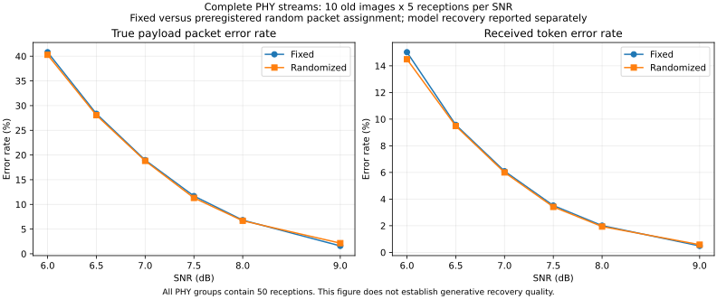

# TokCom 阶段60：独立随机交织对照

记录时间：2026-11-26T02:08:38.708435+00:00（UTC；Asia/Shanghai日期用于文件名）。执行预先保存的stage59_randomized_packetization_plan.json，既有冻结结果保持独立。

## 实际新增与覆盖

本轮新增正式随机PHY 300 组、四路径模型恢复 217 组。当前随机PHY 300/300、模型 217/300，剩余模型 83 组。另有本轮新增诊断传输 4 次，诊断累计 4 次：两次80dB高SNR往返，以及两次没有添加信道噪声的CRC/卷积码/QAM往返；诊断不计入正式300组。新随机模型组均实际计算，没有转用固定基线或约定对照的恢复结果。

| SNR/dB | 固定基线模型/50 | 随机PHY/50 | 随机四路径模型/50 | 配对质量可汇总 |
|---|---:|---:|---:|---|
| 6 | 50 | 50 | 37 | 否 |
| 6.5 | 50 | 50 | 36 | 否 |
| 7 | 50 | 50 | 36 | 否 |
| 7.5 | 50 | 50 | 36 | 否 |
| 8 | 50 | 50 | 36 | 否 |
| 9 | 50 | 50 | 36 | 否 |

## 独立输入与坐标规则

同十张旧开发图、每图五次接收、6/6.5/7/7.5/8/9dB。每图固定PCG64种子202611260+图序号的256位置置换，五次接收和六SNR共享该图置换。发送前置换，接收ID、oracle与CRC token掩码经逆置换恢复到原图坐标后再解码或生成。错误包按置换后的实际四token成员判断，不能按恢复后的相邻位置重建包。

保留原VQGAN/MaskGIT权重、RGB/Resize((256,256))/ToTensor、演示编码输入x与原解码输出y、原噪声种子公式202611240+100×图序号+接收序号、生成种子20261124和32步参数。w=0/1分别去除/保留同一真值类别；同一随机接收的两种类别模式共享自身oracle掩码。固定和随机分支发送符号及错误包成员可以不同，不强行共用错误位置。PSNR用原始输出，LPIPS用clamp与normalize=True，CLIP用clamp→PIL→官方预处理。

CRC和卷积编码仍按包处理，16-QAM仍采用原全帧映射：payload2560bit、CRC704bit、编码6528bit、1632符号。此处只改包位置分配，没有引入独立包补位、实际重传或CMI传输成本。

## 完整物理接收

| SNR/dB | 固定包PER | 随机包PER | 固定接收TER | 随机接收TER | 随机CRC失败率 |
|---|---:|---:|---:|---:|---:|
| 6 | 40.812500% | 40.281250% | 15.023438% | 14.492188% | 53.656250% |
| 6.5 | 28.343750% | 28.062500% | 9.570312% | 9.484375% | 41.093750% |
| 7 | 18.968750% | 18.812500% | 6.093750% | 6.000000% | 30.250000% |
| 7.5 | 11.687500% | 11.312500% | 3.515625% | 3.414062% | 21.218750% |
| 8 | 6.812500% | 6.687500% | 2.007812% | 1.937500% | 14.656250% |
| 9 | 1.593750% | 2.156250% | 0.484375% | 0.578125% | 6.468750% |

每个SNR、每分支均为50接收，包统计分母3200、token统计分母12800。物理误差分开审计，不从这些统计推断MaskGIT恢复收益；未进行置换种子选择或显著性检验。

## 模型质量与配对门槛

随机模型尚无完整50接收的SNR组，不输出部分组的模型质量均值或固定/随机质量差值。

## 验证与原实验

22项置换/掩码检查、4项实际模型审计隔离检查、5项配对汇总门槛检查均通过；两次高SNR与两次精确无噪链路检查通过。精确无噪检查不添加信道噪声，demapper采用正方差0.01得到有限软LLR，该值不是新增AWGN。模型审计重新核对最终ID、未掩码位置保持、有限指标及理想正确token参考与固定基线一致性；作者TER_af不作为残余TER。

固定多SNR基线300/300保持不变，冻结8dB主实验恢复与指标500/500保持不变，输入约定对照100/100保持不变。主协议SHA256：`e71782b05620880888cdf898cfeab3ceb2cca6878f88dc76f4afe9327c698cc1`；主汇总：`c1590aef6aec5e4257a46ed79174dc8ce0f11b21d2bf7ee314a0804053d96979`；预先计划：`3b71a6ceb98ff8bddd6b8bd9e8dfc3067c0e3fc13531d2f5336bcf678d90de7a`；首次新推理前已绑定完整固定基线审计：`b3810a4889c98108e18b88f421a8d817e1467a7d6c04bb096967683478e48436`。代码、输入与执行锁均在独立命名空间，历史报告不改写。

本研究为旧Imagenette开发图的随机包分配敏感性分析，不是ImageNet100数据集复现，也未恢复论文未公开的具体随机种子。类别条件完美提供、oracle需要发送端真值、理想正确token不是重传结果；资源等价基线与整篇论文复现仍未完成。

## 发布与续跑

保持执行规范、PHY/模型执行锁及原缓存，运行run_stage60_randomized_recovery.py继续缺失组，再运行audit_stage60_randomized_recovery.py和audit_stage60_paired_packetization.py。每SNR两分支均齐备50接收后才汇总全部四路径与逐图配对差值。发布提交、实际CI和精确Git对象核验另写本地回执，避免自引用。草稿PR：https://github.com/zhoujinyi8/tokencomm/pull/2 。

PHY缓存和精确无噪诊断使用独立TensorFlow2.15.1/Sionna0.19.2环境；模型恢复及结果审计使用主PyTorch环境。既有正式PHY已完整时不重复模拟，模型入口自动跳过身份匹配的完整组。
