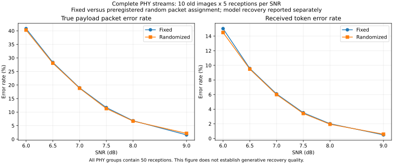
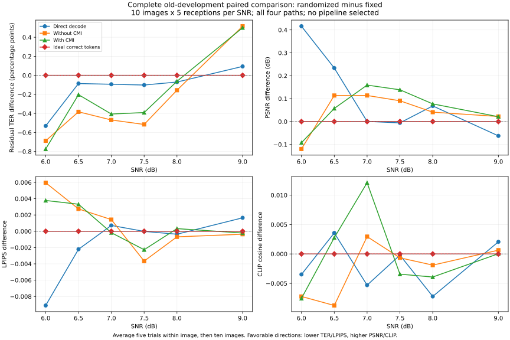
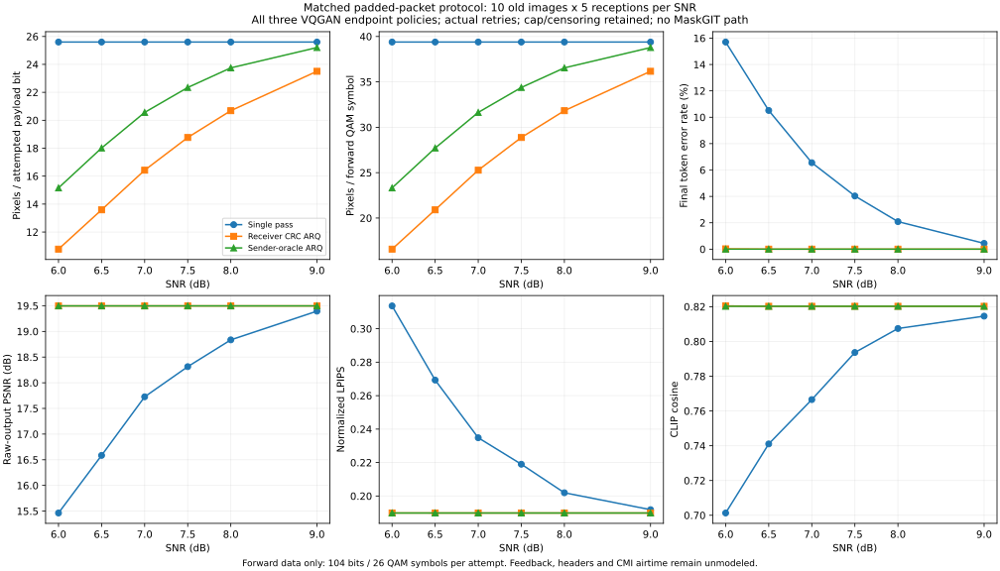

# TokCom 阶段61：独立随机交织对照

记录时间：2026-11-27T10:04:53.073821+00:00（UTC；Asia/Shanghai日期用于文件名）。执行预先保存的stage59_randomized_packetization_plan.json，既有冻结结果保持独立。

## 实际新增与覆盖

本轮新增正式随机PHY 0 组、四路径模型恢复 83 组。当前随机PHY 300/300、模型 300/300，剩余模型 0 组。另有本轮新增诊断传输 0 次，诊断累计 4 次：两次80dB高SNR往返，以及两次没有添加信道噪声的CRC/卷积码/QAM往返；诊断不计入正式300组。新随机模型组均实际计算，没有转用固定基线或约定对照的恢复结果。

| SNR/dB | 固定基线模型/50 | 随机PHY/50 | 随机四路径模型/50 | 配对质量可汇总 |
|---|---:|---:|---:|---|
| 6 | 50 | 50 | 50 | 是 |
| 6.5 | 50 | 50 | 50 | 是 |
| 7 | 50 | 50 | 50 | 是 |
| 7.5 | 50 | 50 | 50 | 是 |
| 8 | 50 | 50 | 50 | 是 |
| 9 | 50 | 50 | 50 | 是 |

## 独立输入与坐标规则

同十张旧开发图、每图五次接收、6/6.5/7/7.5/8/9dB。每图固定PCG64种子202611260+图序号的256位置置换，五次接收和六SNR共享该图置换。发送前置换，接收ID、oracle与CRC token掩码经逆置换恢复到原图坐标后再解码或生成。错误包按置换后的实际四token成员判断，不能按恢复后的相邻位置重建包。

保留原VQGAN/MaskGIT权重、RGB/Resize((256,256))/ToTensor、演示编码输入x与原解码输出y、原噪声种子公式202611240+100×图序号+接收序号、生成种子20261124和32步参数。w=0/1分别去除/保留同一真值类别；同一随机接收的两种类别模式共享自身oracle掩码。固定和随机分支发送符号及错误包成员可以不同，不强行共用错误位置。PSNR用原始输出，LPIPS用clamp与normalize=True，CLIP用clamp→PIL→官方预处理。

CRC和卷积编码仍按包处理，16-QAM仍采用原全帧映射：payload2560bit、CRC704bit、编码6528bit、1632符号。此处只改包位置分配，没有引入独立包补位、实际重传或CMI传输成本。

## 完整物理接收

| SNR/dB | 固定包PER | 随机包PER | 固定接收TER | 随机接收TER | 随机CRC失败率 |
|---|---:|---:|---:|---:|---:|
| 6 | 40.812500% | 40.281250% | 15.023438% | 14.492188% | 53.656250% |
| 6.5 | 28.343750% | 28.062500% | 9.570312% | 9.484375% | 41.093750% |
| 7 | 18.968750% | 18.812500% | 6.093750% | 6.000000% | 30.250000% |
| 7.5 | 11.687500% | 11.312500% | 3.515625% | 3.414062% | 21.218750% |
| 8 | 6.812500% | 6.687500% | 2.007812% | 1.937500% | 14.656250% |
| 9 | 1.593750% | 2.156250% | 0.484375% | 0.578125% | 6.468750% |

每个SNR、每分支均为50接收，包统计分母3200、token统计分母12800。物理误差分开审计，不从这些统计推断MaskGIT恢复收益；未进行置换种子选择或显著性检验。

## 模型质量与配对门槛

| SNR/dB | 分支 | 路径 | 正确token/256 | 残余TER | PSNR/dB | LPIPS | CLIP |
|---|---|---|---:|---:|---:|---:|---:|
| 6.0 | fixed | direct | 217.540000 | 15.023437% | 15.358138 | 0.306193 | 0.697298 |
| 6.0 | fixed | without_cmi | 161.080000 | 37.078125% | 16.617449 | 0.284566 | 0.758608 |
| 6.0 | fixed | with_cmi | 161.780000 | 36.804688% | 16.788092 | 0.270245 | 0.793563 |
| 6.0 | fixed | ideal_correct_tokens | 256.000000 | 0.000000% | 19.497130 | 0.189839 | 0.820243 |
| 6.0 | randomized | direct | 218.900000 | 14.492188% | 15.774137 | 0.297081 | 0.693814 |
| 6.0 | randomized | without_cmi | 162.840000 | 36.390625% | 16.497641 | 0.290524 | 0.751380 |
| 6.0 | randomized | with_cmi | 163.760000 | 36.031250% | 16.695667 | 0.274023 | 0.786004 |
| 6.0 | randomized | ideal_correct_tokens | 256.000000 | 0.000000% | 19.497130 | 0.189839 | 0.820243 |
| 6.5 | fixed | direct | 231.500000 | 9.570312% | 16.737147 | 0.259220 | 0.745705 |
| 6.5 | fixed | without_cmi | 191.220000 | 25.304688% | 17.534004 | 0.245341 | 0.782099 |
| 6.5 | fixed | with_cmi | 191.600000 | 25.156250% | 17.666600 | 0.236896 | 0.803394 |
| 6.5 | fixed | ideal_correct_tokens | 256.000000 | 0.000000% | 19.497130 | 0.189839 | 0.820243 |
| 6.5 | randomized | direct | 231.720000 | 9.484375% | 16.970725 | 0.257011 | 0.749275 |
| 6.5 | randomized | without_cmi | 192.200000 | 24.921875% | 17.647609 | 0.248084 | 0.773336 |
| 6.5 | randomized | with_cmi | 192.120000 | 24.953125% | 17.723882 | 0.240213 | 0.806160 |
| 6.5 | randomized | ideal_correct_tokens | 256.000000 | 0.000000% | 19.497130 | 0.189839 | 0.820243 |
| 7.0 | fixed | direct | 240.400000 | 6.093750% | 17.708821 | 0.230705 | 0.784440 |
| 7.0 | fixed | without_cmi | 212.920000 | 16.828125% | 18.112070 | 0.224113 | 0.796054 |
| 7.0 | fixed | with_cmi | 213.100000 | 16.757813% | 18.140020 | 0.221072 | 0.803917 |
| 7.0 | fixed | ideal_correct_tokens | 256.000000 | 0.000000% | 19.497130 | 0.189839 | 0.820243 |
| 7.0 | randomized | direct | 240.640000 | 6.000000% | 17.709292 | 0.231420 | 0.779135 |
| 7.0 | randomized | without_cmi | 214.120000 | 16.359375% | 18.225795 | 0.225548 | 0.799000 |
| 7.0 | randomized | with_cmi | 214.140000 | 16.351562% | 18.299132 | 0.220897 | 0.816022 |
| 7.0 | randomized | ideal_correct_tokens | 256.000000 | 0.000000% | 19.497130 | 0.189839 | 0.820243 |
| 7.5 | fixed | direct | 247.000000 | 3.515625% | 18.477437 | 0.213207 | 0.801438 |
| 7.5 | fixed | without_cmi | 229.940000 | 10.179688% | 18.719424 | 0.210281 | 0.810927 |
| 7.5 | fixed | with_cmi | 229.980000 | 10.164062% | 18.703010 | 0.208980 | 0.819693 |
| 7.5 | fixed | ideal_correct_tokens | 256.000000 | 0.000000% | 19.497130 | 0.189839 | 0.820243 |
| 7.5 | randomized | direct | 247.260000 | 3.414062% | 18.471671 | 0.213189 | 0.801231 |
| 7.5 | randomized | without_cmi | 231.260000 | 9.664062% | 18.810046 | 0.206620 | 0.810267 |
| 7.5 | randomized | with_cmi | 230.980000 | 9.773438% | 18.841609 | 0.206714 | 0.816255 |
| 7.5 | randomized | ideal_correct_tokens | 256.000000 | 0.000000% | 19.497130 | 0.189839 | 0.820243 |
| 8.0 | fixed | direct | 250.860000 | 2.007812% | 18.871355 | 0.203795 | 0.815378 |
| 8.0 | fixed | without_cmi | 240.960000 | 5.875000% | 19.039033 | 0.200729 | 0.814762 |
| 8.0 | fixed | with_cmi | 241.140000 | 5.804688% | 19.047309 | 0.199192 | 0.818000 |
| 8.0 | fixed | ideal_correct_tokens | 256.000000 | 0.000000% | 19.497130 | 0.189839 | 0.820243 |
| 8.0 | randomized | direct | 251.040000 | 1.937500% | 18.939482 | 0.203433 | 0.808156 |
| 8.0 | randomized | without_cmi | 241.360000 | 5.718750% | 19.079926 | 0.200046 | 0.812862 |
| 8.0 | randomized | with_cmi | 241.300000 | 5.742188% | 19.124333 | 0.199515 | 0.814078 |
| 8.0 | randomized | ideal_correct_tokens | 256.000000 | 0.000000% | 19.497130 | 0.189839 | 0.820243 |
| 9.0 | fixed | direct | 254.760000 | 0.484375% | 19.364361 | 0.192547 | 0.815903 |
| 9.0 | fixed | without_cmi | 252.480000 | 1.375000% | 19.350757 | 0.192725 | 0.818831 |
| 9.0 | fixed | with_cmi | 252.480000 | 1.375000% | 19.351310 | 0.192549 | 0.819375 |
| 9.0 | fixed | ideal_correct_tokens | 256.000000 | 0.000000% | 19.497130 | 0.189839 | 0.820243 |
| 9.0 | randomized | direct | 254.520000 | 0.578125% | 19.301848 | 0.194200 | 0.817961 |
| 9.0 | randomized | without_cmi | 251.160000 | 1.890625% | 19.372868 | 0.192362 | 0.819472 |
| 9.0 | randomized | with_cmi | 251.200000 | 1.875000% | 19.372402 | 0.192335 | 0.819416 |
| 9.0 | randomized | ideal_correct_tokens | 256.000000 | 0.000000% | 19.497130 | 0.189839 | 0.820243 |

先对每图五次接收平均，再平均十图；全部四路径与逐图配对差值保存在配对审计JSON。未完整的SNR不参与质量汇总，不选择最佳流水线。

| SNR/dB | 路径：随机减固定 | 正确token差值 | TER差值/百分点 | PSNR差值/dB | LPIPS差值 | CLIP差值 |
|---|---|---:|---:|---:|---:|---:|
| 6.0 | direct | +1.360000 | -0.531250 | +0.415999 | -0.009112 | -0.003483 |
| 6.0 | without_cmi | +1.760000 | -0.687500 | -0.119808 | +0.005958 | -0.007229 |
| 6.0 | with_cmi | +1.980000 | -0.773437 | -0.092424 | +0.003778 | -0.007559 |
| 6.0 | ideal_correct_tokens | +0.000000 | +0.000000 | +0.000000 | +0.000000 | +0.000000 |
| 6.5 | direct | +0.220000 | -0.085938 | +0.233578 | -0.002209 | +0.003570 |
| 6.5 | without_cmi | +0.980000 | -0.382813 | +0.113605 | +0.002742 | -0.008763 |
| 6.5 | with_cmi | +0.520000 | -0.203125 | +0.057282 | +0.003317 | +0.002766 |
| 6.5 | ideal_correct_tokens | +0.000000 | +0.000000 | +0.000000 | +0.000000 | +0.000000 |
| 7.0 | direct | +0.240000 | -0.093750 | +0.000471 | +0.000715 | -0.005304 |
| 7.0 | without_cmi | +1.200000 | -0.468750 | +0.113725 | +0.001434 | +0.002946 |
| 7.0 | with_cmi | +1.040000 | -0.406250 | +0.159112 | -0.000174 | +0.012105 |
| 7.0 | ideal_correct_tokens | +0.000000 | +0.000000 | +0.000000 | +0.000000 | +0.000000 |
| 7.5 | direct | +0.260000 | -0.101562 | -0.005766 | -0.000018 | -0.000206 |
| 7.5 | without_cmi | +1.320000 | -0.515625 | +0.090622 | -0.003661 | -0.000660 |
| 7.5 | with_cmi | +1.000000 | -0.390625 | +0.138600 | -0.002266 | -0.003438 |
| 7.5 | ideal_correct_tokens | +0.000000 | +0.000000 | +0.000000 | +0.000000 | +0.000000 |
| 8.0 | direct | +0.180000 | -0.070313 | +0.068126 | -0.000362 | -0.007222 |
| 8.0 | without_cmi | +0.400000 | -0.156250 | +0.040893 | -0.000683 | -0.001901 |
| 8.0 | with_cmi | +0.160000 | -0.062500 | +0.077024 | +0.000324 | -0.003923 |
| 8.0 | ideal_correct_tokens | +0.000000 | +0.000000 | +0.000000 | +0.000000 | +0.000000 |
| 9.0 | direct | -0.240000 | +0.093750 | -0.062513 | +0.001653 | +0.002058 |
| 9.0 | without_cmi | -1.320000 | +0.515625 | +0.022111 | -0.000363 | +0.000641 |
| 9.0 | with_cmi | -1.280000 | +0.500000 | +0.021092 | -0.000214 | +0.000040 |
| 9.0 | ideal_correct_tokens | +0.000000 | +0.000000 | +0.000000 | +0.000000 | +0.000000 |

图为十张旧开发图的配对均值；逐图值保存在JSON，没有据此选择新的流水线或声称显著性。

## 独立匹配填充包重传协议

本轮另完成 300 个新协议帧实验，累计 300/300；两次无噪诊断另计。预先指定24帧试点通过停止规则与账本验证后，按同一计划继续缺失帧，没有按性能筛选样本。每包40bit payload+11bit CRC，经半率卷积编码为102bit，再补2bit形成104bit/26个QAM符号；三策略首发相同，重试使用每包/每次尝试独立PCG64噪声，最多32次，截断和CRC错误接受均保留。

| 策略 | 实际包尝试数 | 前向wire bit | 前向QAM符号 | 逻辑反馈事件 | CRC接受但payload错误包 | 截断包 |
|---|---:|---:|---:|---:|---:|---:|
| single_pass_padded | 19200 | 1996800 | 499200 | 0 | 0 | 0 |
| receiver_crc_arq_padded | 30428 | 3164512 | 791128 | 30428 | 1 | 0 |
| sender_oracle_arq_padded | 24301 | 2527304 | 631826 | 24301 | 0 | 0 |

CRC策略只根据接收端校验停止，发送端真值策略只是理想参考。共同噪声下模拟仍被任一策略需要的包，联合仿真观察数30430不等于每种策略的收费成本。反馈只记录事件数，反馈编码/头部/CMI airtime与延迟均未建模；当前协议不构成完整资源等价论文基线。先前完整帧映射为1632符号，此协议首发为1664符号，旧MaskGIT结果没有被当作本协议下的神经恢复路径。

首次无噪前置检查在正式采样前发现QAM Mapper输入维度错误；已保留失败源哈希与旧锁，修正后使用v2执行锁重新通过无噪检查，预先计划未改变，失败版本未产生正式接收数据。

端点VQGAN图像指标已评估300/300帧、900行；本次实际解码forward为298次，612行通过精确sender-ID相等复用同图确定性干净参考。未使用MaskGIT。未齐备50帧的SNR不汇总端点质量。

| SNR/dB | 策略 | payload TCE（总量比） | pixels/前向QAM符号（总量比） | 残余TER | PSNR/dB | LPIPS | CLIP |
|---|---|---:|---:|---:|---:|---:|---:|
| 6.0 | single_pass_padded | 25.600000 | 39.384615 | 15.703125% | 15.462705 | 0.313650 | 0.701313 |
| 6.0 | receiver_crc_arq_padded | 10.774694 | 16.576453 | 0.023438% | 19.497296 | 0.189858 | 0.820465 |
| 6.0 | sender_oracle_arq_padded | 15.159141 | 23.321756 | 0.000000% | 19.497130 | 0.189839 | 0.820243 |
| 6.5 | single_pass_padded | 25.600000 | 39.384615 | 10.515625% | 16.584997 | 0.269307 | 0.741059 |
| 6.5 | receiver_crc_arq_padded | 13.589914 | 20.907560 | 0.000000% | 19.497130 | 0.189839 | 0.820243 |
| 6.5 | sender_oracle_arq_padded | 18.012313 | 27.711251 | 0.000000% | 19.497130 | 0.189839 | 0.820243 |
| 7.0 | single_pass_padded | 25.600000 | 39.384615 | 6.554687% | 17.726440 | 0.234823 | 0.766558 |
| 7.0 | receiver_crc_arq_padded | 16.426709 | 25.271861 | 0.000000% | 19.497130 | 0.189839 | 0.820243 |
| 7.0 | sender_oracle_arq_padded | 20.562249 | 31.634229 | 0.000000% | 19.497130 | 0.189839 | 0.820243 |
| 7.5 | single_pass_padded | 25.600000 | 39.384615 | 4.031250% | 18.313654 | 0.218995 | 0.793653 |
| 7.5 | receiver_crc_arq_padded | 18.767468 | 28.873028 | 0.000000% | 19.497130 | 0.189839 | 0.820243 |
| 7.5 | sender_oracle_arq_padded | 22.345881 | 34.378279 | 0.000000% | 19.497130 | 0.189839 | 0.820243 |
| 8.0 | single_pass_padded | 25.600000 | 39.384615 | 2.085938% | 18.835508 | 0.201933 | 0.807459 |
| 8.0 | receiver_crc_arq_padded | 20.686869 | 31.825952 | 0.000000% | 19.497130 | 0.189839 | 0.820243 |
| 8.0 | sender_oracle_arq_padded | 23.751812 | 36.541249 | 0.000000% | 19.497130 | 0.189839 | 0.820243 |
| 9.0 | single_pass_padded | 25.600000 | 39.384615 | 0.437500% | 19.394896 | 0.191822 | 0.814573 |
| 9.0 | receiver_crc_arq_padded | 23.506456 | 36.163779 | 0.000000% | 19.497130 | 0.189839 | 0.820243 |
| 9.0 | sender_oracle_arq_padded | 25.206154 | 38.778698 | 0.000000% | 19.497130 | 0.189839 | 0.820243 |

成本效率采用每SNR总pixels除以总资源；图像质量先平均每图五次接收，再平均十图。

### 下一轮匹配帧输入

随机交织300组及本轮ARQ端点评估均已完成。下一轮按独立预先计划实现并锁定六路径匹配填充帧模型入口与审计，再对300份已验证输入进行恢复；保持每帧1664前向QAM符号的首发条件一致。六路径包含direct、oracle/CRC掩码各自有无CMI和ideal。本轮仅准备这些输入，没有执行该新研究的Transformer恢复，也没有移用旧1632符号模型端点。

## 验证与原实验

22项置换/掩码检查、4项实际模型审计隔离检查、5项配对汇总门槛检查均通过；两次高SNR与两次精确无噪链路检查通过。精确无噪检查不添加信道噪声，demapper采用正方差0.01得到有限软LLR，该值不是新增AWGN。模型审计重新核对最终ID、未掩码位置保持、有限指标及理想正确token参考与固定基线一致性；作者TER_af不作为残余TER。

固定多SNR基线300/300保持不变，冻结8dB主实验恢复与指标500/500保持不变，输入约定对照100/100保持不变。主协议SHA256：`e71782b05620880888cdf898cfeab3ceb2cca6878f88dc76f4afe9327c698cc1`；主汇总：`c1590aef6aec5e4257a46ed79174dc8ce0f11b21d2bf7ee314a0804053d96979`；预先计划：`3b71a6ceb98ff8bddd6b8bd9e8dfc3067c0e3fc13531d2f5336bcf678d90de7a`；首次新推理前已绑定完整固定基线审计：`b3810a4889c98108e18b88f421a8d817e1467a7d6c04bb096967683478e48436`。代码、输入与执行锁均在独立命名空间，历史报告不改写。

本研究为旧Imagenette开发图的随机包分配敏感性分析，不是ImageNet100数据集复现，也未恢复论文未公开的具体随机种子。类别条件完美提供、oracle需要发送端真值、理想正确token不是重传结果；资源等价基线与整篇论文复现仍未完成。

## 发布与续跑

随机交织300组及本轮ARQ端点评估均已完成。下一轮按独立预先计划实现并锁定六路径匹配填充帧模型入口与审计，再对300份已验证输入进行恢复；保持每帧1664前向QAM符号的首发条件一致。六路径包含direct、oracle/CRC掩码各自有无CMI和ideal。本轮仅准备这些输入，没有执行该新研究的Transformer恢复，也没有移用旧1632符号模型端点。 发布提交、实际CI和精确Git对象核验另写本地回执，避免自引用。草稿PR：https://github.com/zhoujinyi8/tokencomm/pull/2 。

PHY缓存和精确无噪诊断使用独立TensorFlow2.15.1/Sionna0.19.2环境；模型恢复及结果审计使用主PyTorch环境。既有正式PHY已完整时不重复模拟，模型入口自动跳过身份匹配的完整组。
