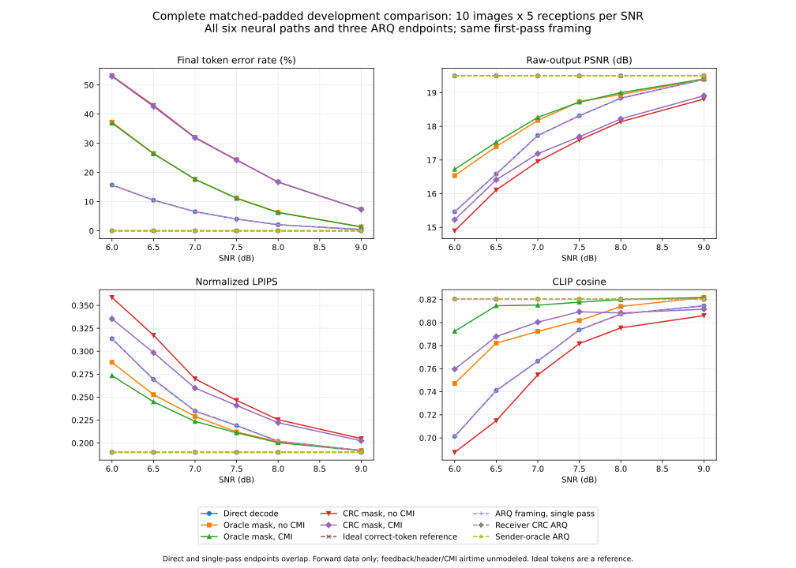

# 阶段64：相同填充帧格式的六路径模型恢复

记录时间：2026-11-28T01:31:17.298800+00:00。本轮新增 106 组，累计审计 300 组接收，每组保存六路径最终token和质量记录，共 1800 行；计划总量300组。未新增物理模拟，使用上一轮已冻结的300份首发输入。

| SNR/dB | 完成接收 |
|---|---:|
| 6.0 | 50/50 |
| 6.5 | 50/50 |
| 7.0 | 50/50 |
| 7.5 | 50/50 |
| 8.0 | 50/50 |
| 9.0 | 50/50 |

## 完整分组的六路径与三种ARQ对照

| SNR/dB | 路径 | 残余TER | PSNR/dB | LPIPS | CLIP | pixels/前向QAM符号 |
|---|---|---:|---:|---:|---:|---:|
| 6.0 | direct | 15.703125% | 15.462705 | 0.313650 | 0.701313 | 39.384615 |
| 6.0 | oracle_without_cmi | 37.257813% | 16.538556 | 0.287844 | 0.747190 | 39.384615 |
| 6.0 | oracle_with_cmi | 36.921875% | 16.723881 | 0.273407 | 0.792512 | 39.384615 |
| 6.0 | receiver_crc_without_cmi | 53.101562% | 14.897632 | 0.358637 | 0.687479 | 39.384615 |
| 6.0 | receiver_crc_with_cmi | 52.945313% | 15.227158 | 0.335325 | 0.759596 | 39.384615 |
| 6.0 | ideal_correct_tokens | 0.000000% | 19.497130 | 0.189839 | 0.820243 | 参考 |
| 6.0 | single_pass_padded | 15.703125% | 15.462705 | 0.313650 | 0.701313 | 39.384615 |
| 6.0 | receiver_crc_arq_padded | 0.023438% | 19.497296 | 0.189858 | 0.820465 | 16.576453 |
| 6.0 | sender_oracle_arq_padded | 0.000000% | 19.497130 | 0.189839 | 0.820243 | 23.321756 |
| 6.5 | direct | 10.515625% | 16.584997 | 0.269307 | 0.741059 | 39.384615 |
| 6.5 | oracle_without_cmi | 26.523437% | 17.397036 | 0.252675 | 0.782182 | 39.384615 |
| 6.5 | oracle_with_cmi | 26.421875% | 17.529712 | 0.244884 | 0.814654 | 39.384615 |
| 6.5 | receiver_crc_without_cmi | 42.960937% | 16.111089 | 0.317433 | 0.714928 | 39.384615 |
| 6.5 | receiver_crc_with_cmi | 42.617188% | 16.411356 | 0.298384 | 0.787955 | 39.384615 |
| 6.5 | ideal_correct_tokens | 0.000000% | 19.497130 | 0.189839 | 0.820243 | 参考 |
| 6.5 | single_pass_padded | 10.515625% | 16.584997 | 0.269307 | 0.741059 | 39.384615 |
| 6.5 | receiver_crc_arq_padded | 0.000000% | 19.497130 | 0.189839 | 0.820243 | 20.907560 |
| 6.5 | sender_oracle_arq_padded | 0.000000% | 19.497130 | 0.189839 | 0.820243 | 27.711251 |
| 7.0 | direct | 6.554687% | 17.726440 | 0.234823 | 0.766558 | 39.384615 |
| 7.0 | oracle_without_cmi | 17.671875% | 18.175520 | 0.229000 | 0.792363 | 39.384615 |
| 7.0 | oracle_with_cmi | 17.632812% | 18.266203 | 0.223504 | 0.815139 | 39.384615 |
| 7.0 | receiver_crc_without_cmi | 31.968750% | 16.957692 | 0.269954 | 0.754686 | 39.384615 |
| 7.0 | receiver_crc_with_cmi | 31.812500% | 17.188058 | 0.259884 | 0.800396 | 39.384615 |
| 7.0 | ideal_correct_tokens | 0.000000% | 19.497130 | 0.189839 | 0.820243 | 参考 |
| 7.0 | single_pass_padded | 6.554687% | 17.726440 | 0.234823 | 0.766558 | 39.384615 |
| 7.0 | receiver_crc_arq_padded | 0.000000% | 19.497130 | 0.189839 | 0.820243 | 25.271861 |
| 7.0 | sender_oracle_arq_padded | 0.000000% | 19.497130 | 0.189839 | 0.820243 | 31.634229 |
| 7.5 | direct | 4.031250% | 18.313654 | 0.218995 | 0.793653 | 39.384615 |
| 7.5 | oracle_without_cmi | 11.218750% | 18.730816 | 0.212077 | 0.801736 | 39.384615 |
| 7.5 | oracle_with_cmi | 11.117187% | 18.720579 | 0.211068 | 0.817723 | 39.384615 |
| 7.5 | receiver_crc_without_cmi | 24.312500% | 17.593534 | 0.246453 | 0.781773 | 39.384615 |
| 7.5 | receiver_crc_with_cmi | 24.218750% | 17.689109 | 0.240879 | 0.809368 | 39.384615 |
| 7.5 | ideal_correct_tokens | 0.000000% | 19.497130 | 0.189839 | 0.820243 | 参考 |
| 7.5 | single_pass_padded | 4.031250% | 18.313654 | 0.218995 | 0.793653 | 39.384615 |
| 7.5 | receiver_crc_arq_padded | 0.000000% | 19.497130 | 0.189839 | 0.820243 | 28.873028 |
| 7.5 | sender_oracle_arq_padded | 0.000000% | 19.497130 | 0.189839 | 0.820243 | 34.378279 |
| 8.0 | direct | 2.085938% | 18.835508 | 0.201933 | 0.807459 | 39.384615 |
| 8.0 | oracle_without_cmi | 6.359375% | 18.949474 | 0.201265 | 0.814001 | 39.384615 |
| 8.0 | oracle_with_cmi | 6.242187% | 19.000820 | 0.200378 | 0.819980 | 39.384615 |
| 8.0 | receiver_crc_without_cmi | 16.695312% | 18.137677 | 0.225405 | 0.795430 | 39.384615 |
| 8.0 | receiver_crc_with_cmi | 16.710937% | 18.222392 | 0.222095 | 0.808393 | 39.384615 |
| 8.0 | ideal_correct_tokens | 0.000000% | 19.497130 | 0.189839 | 0.820243 | 参考 |
| 8.0 | single_pass_padded | 2.085938% | 18.835508 | 0.201933 | 0.807459 | 39.384615 |
| 8.0 | receiver_crc_arq_padded | 0.000000% | 19.497130 | 0.189839 | 0.820243 | 31.825952 |
| 8.0 | sender_oracle_arq_padded | 0.000000% | 19.497130 | 0.189839 | 0.820243 | 36.541249 |
| 9.0 | direct | 0.437500% | 19.394896 | 0.191822 | 0.814573 | 39.384615 |
| 9.0 | oracle_without_cmi | 1.375000% | 19.399120 | 0.191793 | 0.821833 | 39.384615 |
| 9.0 | oracle_with_cmi | 1.343750% | 19.406812 | 0.191581 | 0.821772 | 39.384615 |
| 9.0 | receiver_crc_without_cmi | 7.289062% | 18.811439 | 0.204780 | 0.806082 | 39.384615 |
| 9.0 | receiver_crc_with_cmi | 7.296875% | 18.910269 | 0.202458 | 0.811647 | 39.384615 |
| 9.0 | ideal_correct_tokens | 0.000000% | 19.497130 | 0.189839 | 0.820243 | 参考 |
| 9.0 | single_pass_padded | 0.437500% | 19.394896 | 0.191822 | 0.814573 | 39.384615 |
| 9.0 | receiver_crc_arq_padded | 0.000000% | 19.497130 | 0.189839 | 0.820243 | 36.163779 |
| 9.0 | sender_oracle_arq_padded | 0.000000% | 19.497130 | 0.189839 | 0.820243 | 38.778698 |

质量先平均每图五次接收，再平均十图；成本按总pixels/总前向符号计算。所有路径对三种ARQ的逐图配对差值均保存在机器回执中，不选赢家、不作显著性结论。理想正确token仅作质量参考，不赋予可实现传输成本。未计反馈、包头、类别信息空口开销。

## 描述性方向核对

| 生成路径 | PSNR高于直接解码 | LPIPS低于直接解码 | CLIP高于直接解码 | TER低于直接解码 |
|---|---:|---:|---:|---:|
| oracle_without_cmi | 6/6 | 6/6 | 6/6 | 0/6 |
| oracle_with_cmi | 6/6 | 6/6 | 6/6 | 0/6 |
| receiver_crc_without_cmi | 0/6 | 0/6 | 0/6 | 0/6 |
| receiver_crc_with_cmi | 0/6 | 0/6 | 5/6 | 0/6 |

这些是六个固定SNR的方向统计，不是独立重复或显著性检验。oracle路径依赖真实错误位置，CRC路径保留实际CRC检测结果；本轮结果不支持把oracle掩码收益直接外推到CRC接收实现。token精确匹配与像素/语义质量需分别解读。

六路径：直接解码、oracle掩码有无类别信息、接收端CRC掩码有无类别信息、理想正确token。四种生成路径使用各自正确掩码，同一掩码两种类别模式共享输入；生成种子20261124，32步。保留原demo输入x与原始解码y、权重和指标约定。CRC错误接受造成的未掩码错误保留，不能利用发送端真值偷偷修正CRC掩码。

每帧首发1664个前向QAM符号，与stage61实际包ARQ相同；未计反馈、包头和类别信息传输成本。oracle仍需要发送端真值。本轮不复用旧1632符号研究的生成端点。每SNR六路径均齐备50组后才能汇总质量；当前完整SNR组为6。未完整分组不发布质量均值。

既有六项纯逻辑检查通过，包括CRC未检错误保持、oracle未掩码位置保持、错误计数、非有限指标和缺路径拒绝。执行锁绑定入口、审计器、检查函数、测试、计划、输入审计和指标身份。审计复核最终token、两种掩码、源文件SHA256、有限指标和理想干净参考。

原主实验500组、固定分组300组、随机分组300组、输入约定对照100组保持独立。整篇论文复现未完成，仍是旧Imagenette十图开发实验。

## 下一阶段数据协议证据

本轮只读核对作者固定提交0422ed32dcde3347e0bb6697f343f7a9ff7b3214的演示notebook：默认class_indices为[503,498]、每类40张、SNR为[5,7]；数据加载单元另使用固定目录，文件列表未排序后random.sample。该证据仅说明此版本演示配置，不能据此确定论文完整100类清单、测试划分或精确图像身份。未修改作者源码、未下载新数据，也未改变本轮十图设置。下一步优先补齐100类synset清单、图像ID及SHA256、采样顺序与种子、Cheng配置和完整资源开销协议。

六路径恢复已齐备300组，保存完整对照并推进数据集及剩余资源开销对齐。保持执行锁及已有缓存；依然只汇总完整SNR，最终与stage61同帧格式的三种ARQ端点比较。GitHub草稿PR：https://github.com/zhoujinyi8/tokencomm/pull/2 。
