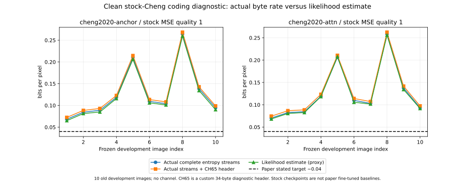

# 阶段65：Cheng实际码流、低码率准备和数据协议

记录时间：2026-11-28T06:28:45.640740+00:00。

## 已完成的stock码流诊断

独立Cheng环境完成两种公开Cheng变体、同一批十张旧开发图、各一个最低质量档位，共20/20个干净码流案例。原生rANS及CDF后端8项检查通过；两次独立进程仅用完整熵流、形状和固定权重解码，未读取原图、未调用编码器，像素最大差均为0。实际码率由两个完整熵流的字节数计算，似然估计另列。没有训练这些stock模型，也没有给本项诊断加入有噪信道或重传。

| 模型（stock MSE q1） | 实际熵流bpp | 含自定义头bpp | 似然估计bpp | 相对0.04目标 | PSNR/dB | LPIPS | CLIP | 平均首发QAM符号 |
|---|---:|---:|---:|---:|---:|---:|---:|---:|
| cheng2020-anchor | 0.128174 | 0.132324 | 0.124490 | 3.204倍 | 29.198 | 0.216340 | 0.802694 | 5647.2 |
| cheng2020-attn | 0.126514 | 0.130664 | 0.124653 | 3.163倍 | 29.167 | 0.226613 | 0.806692 | 5574.4 |

[TokCom arXiv v5第VI节](https://arxiv.org/html/2502.12096v5#S6)说明Cheng基线经过微调，目标约为0.04 bpp。此处公开q1模型仍约为目标的3.2倍，不能把它们的重建质量直接当作论文的等码率Cheng基线，也未将它们与TokCom作同码率优劣结论。作者的精确Cheng变体、微调权重、训练数据与训练配方仍待确定。

## 容器与首发账本

CH65是本工程定义的34字节头，包含模型/质量标识、图像与熵流形状、两个流长度；它不是已确定的作者报头。上表含头码率与纯熵流分开记录。账本把完整容器按40bit负载分包，尾部补零，逐包CRC11、半率卷积编码、再补2bit形成104bit/26个QAM符号。20个案例均经字节往返和整数账本核对；这里只计算首发资源，没有模拟信道、反馈或CMI。

## 单步训练通路与独立代理校准

单步训练smoke从原始Anchor q1开始，用单独训练图完成一次Adam主参数/辅助量化参数更新；122组主参数发生变化，独立审计发现104个同名浮点张量与stock检查点不同，重载后的解码像素一致。没有覆盖stock权重。该检查不表示已达到目标码率。

随后另立固定预算代理计划：从已有训练集选每类10张、共100张，按SHA排序和固定类间交替顺序，100次更新；lambda=0.0001、主学习率0.0001、辅助学习率0.001、batch=1、固定随机种子。超参数是工程选择，不是已确认的作者配方。按580条现有验证/测试记录的字节、像素和源文件身份排除训练重叠；优化不使用旧开发评估图或冻结主实验图。只在预算结束后对十张旧开发图做码率校准，不选最佳检查点。检查点保存模型、两个优化器和Torch RNG状态。

固定预算代理试点已更新 100/100 次；校准 10/10 张，独立解码复核 10/10 张。校准集实际熵流均值 0.031396 bpp；是否落入预先指定0.04±10%的诊断窗口：False。该容差不是作者给出的判据。同十图stock Anchor PSNR为29.198dB，代理试点为23.270dB，压缩率变化伴随失真变化。本试点仅做码率/PSNR校准，未作语义或感知性能结论。

这仍是十类代理数据上的开发校准，不是百类论文复现或独立最终测试；即使进入诊断码率窗口，论文基线资格仍为False。

## 数据与版本证据

作者当前公开HEAD仍是0422ed32dcde3347e0bb6697f343f7a9ff7b3214；演示notebook的Git对象与首个公开版本相同，默认仅[503,498]两类、每类40图，目录文件未排序后随机取样。现有十类开发集和两类演示均被百类结构门槛明确拒绝。新增清单工具检查100个唯一synset、逐文件SHA256、跨split同图和冻结评估图进入训练等问题；结构合格仍不等于作者数据身份已确认。实际论文百类图像本轮核验数量为0。

[作者公开问题#1](https://github.com/liqiao19/TokenCom_Code/issues/1)提及TER复现疑问，本轮只读检查未见评论回复；没有向作者发送消息。arXiv v5、期刊版和代码版本的完全对应关系仍需核实。下一阶段还需要百类清单、分割/图像身份、准确微调配置和完整反馈/报头/CMI资源协议。

## 环境与校验

CompressAI 1.2.8源码和LLVM-MinGW归档按完整SHA256核验，两个上游C++扩展在工作区编译，源算法未修改。依赖装入独立venv，主TokCom环境保持原状。首次Attention响应内容摘要不符，已隔离且未用于推理；独立复取并固定正确完整摘要后才冻结计划。原主协议、主汇总、固定多SNR、输入约定和完整匹配帧结果均与上次发布字节摘要一致。

新增纯逻辑检查23项：容器8、分包6、数据清单9，均通过；与原20项合计43项加入CI。原生后端8项和实际模型/码流检查需要本地资产，另行记录。GitHub提交、实际CI和精确Git对象同步结果保存到本地发布回执，避免自引用。PR：https://github.com/zhoujinyi8/tokencomm/pull/2 。
