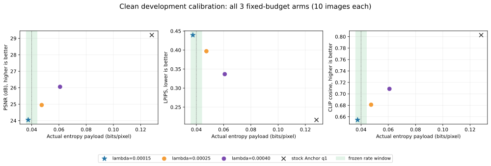
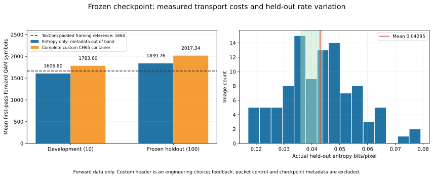
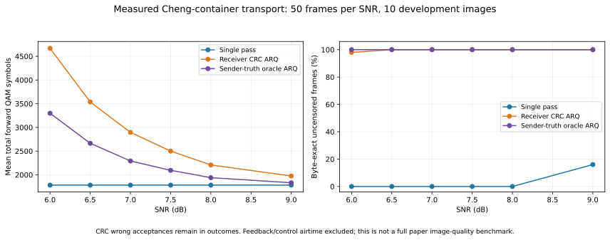

# 阶段66：Cheng低码率开发校准、固定留出验证与实际字节传输

记录时间：2026-11-28T11:18:57.793381+00:00。本轮从阶段65已审计的0.031396 bpp试点继续，另建新计划；未改写此前实验结果。

## 三设置固定预算校准

三个Cheng Anchor设置分别从同一公开q1权重开始，使用同一100张训练图、图像顺序、随机种子和100次更新预算。主学习率0.0001、辅助学习率0.001、batch=1、梯度上限1；损失权重为0.00015、0.00025、0.00040。它们是工程选择，尚未证实为作者配方。训练图按原580条验证/测试记录的文件、像素及源ID排除重叠。

训练前固定规则：三个设置及各十张开发图必须全部完成；只在纯熵流平均码率进入0.036–0.044 bpp后，按距0.04的绝对差选择，精确相等时按冻结顺序；不根据PSNR、LPIPS、CLIP或留出结果选模型。该±10%容差是本工程诊断规则。

| 损失权重 lambda | 开发集实际熵流 bpp | 含34字节头 bpp | PSNR/dB | LPIPS ↓ | CLIP ↑ | 进入预设窗口 |
|---:|---:|---:|---:|---:|---:|:---:|
| 0.00015 | 0.037451 | 0.041602 | 24.046 | 0.439299 | 0.654465 | 是（冻结候选） |
| 0.00025 | 0.047363 | 0.051514 | 24.951 | 0.397004 | 0.681065 | 否 |
| 0.00040 | 0.060840 | 0.064990 | 26.058 | 0.336696 | 0.708751 | 否 |

共300次更新、30次真实开发图编码、30次新进程解码复核均完成；复核像素摘要与编码阶段一致。全部三个设置另测同一规范的感知指标，保留全部结果。

## 冻结候选后的100张十类留出图

选择 `lambda_00015` 后，冻结检查点摘要 `9d06fe8d363b12b18916997469a3076858cab1c73a5d9e7edf00e9107d90c2d7`，再读取原阶段44的100张留出图作本项独立干净编解码评估。这是十类、每类十张的既有留出集，不是论文ImageNet100百类数据集。训练图、开发校准图与本组按冻结身份排除重叠；不重新抽图、训练或选检查点。

| 固定留出评估，100/100张 | 均值 |
|---|---:|
| 实际完整熵流 bpp | 0.042954 |
| 含自定义34字节头 bpp | 0.047104 |
| 似然估计 bpp | 0.039843 |
| 实际重建 PSNR/dB | 23.673 |
| LPIPS（normalize=True） | 0.452458 |
| CLIP（ViT-B/32、PIL裁剪预处理） | 0.643420 |

实际留出熵流码率比0.04高7.39%，仍在开发诊断窗口内。开发集均值为0.037451 bpp，留出集观测均值更高；没有利用此结果再调参。似然估计不能替代实际字节码率。全部100张的像素、字节长度和PSNR经独立审计；预先固定索引0、24、49、74、99由新进程重新解码，像素最大差均为0。每图标量结果保存在 `stage66_session_audit.json`。

## 完整容器和首发资源

| 同样40bit负载、CRC11、半率卷积码、每次26个QAM符号 | 开发10图 | 留出100图 |
|---|---:|---:|
| 纯熵流、所有元数据另传的反事实首发QAM符号 | 1606.80 | 1839.76 |
| 实际完整CH65容器首发QAM符号 | 1783.60 | 2017.34 |
| 完整容器相对TokCom 1664符号分帧参考 | 1.0719倍 | 1.2123倍 |

CH65的34字节头由本工程定义，不是已经确认的论文报头。完整容器账本包含此头、分包尾部补零、CRC、卷积编码和QAM补齐。纯熵流一行假设形状、两个流的边界等信息另行传送，不能视为免费可部署协议。接收端共享检查点及长度约定、分包控制、反馈和CMI的完整空口开销仍未计齐。即使熵流接近0.04 bpp，也不能据此声称资源完全相等。

## 独立物理字节传输研究

另立冻结计划：同一候选的十张开发图完整容器，经连续5字节/40bit分包；6个SNR、每图5次接收，共300帧。CRC11、[101,111]卷积码及16-QAM采用现有Sionna 0.19.2/TensorFlow 2.15.1后端。每包/每次尝试使用固定SeedSequence坐标产生独立AWGN。三种停止规则共享同次噪声：单发原始接收字节、接收端首次CRC通过即停止、发送端真实负载相等的理想参考。最多32次，保留截尾和CRC错误接受，不利用真值延长CRC重传。

两个无噪分帧诊断通过；24帧先导逐次轨迹审计通过后，按相同计划继续。本轮当前审计覆盖 **300/300帧**，完整SNR组 **6/6**；先导24帧摘要保持一致。

| SNR/dB | 单发字节完全正确帧/50 | CRC重传完整且正确帧/50 | CRC错误接受包 | CRC平均前向QAM符号 | 真值参考平均前向QAM符号 |
|---:|---:|---:|---:|---:|---:|
| 6.0 | 0 | 49 | 3 | 4668.56 | 3299.40 |
| 6.5 | 0 | 50 | 0 | 3537.04 | 2665.52 |
| 7.0 | 0 | 50 | 0 | 2895.88 | 2292.68 |
| 7.5 | 0 | 50 | 0 | 2501.20 | 2095.08 |
| 8.0 | 0 | 50 | 0 | 2208.44 | 1940.12 |
| 9.0 | 8 | 50 | 0 | 1975.48 | 1832.48 |

十位分组只是传输适配器，不是语义token；不将其错误数称为TokCom TER。真值重传为理想参考，CRC重传不是无条件可靠保证。完整结果及整数账本见 `stage66_transport_audit.json`。该代理模型、十类开发集和本工程报头尚不构成论文“Cheng”和“Cheng+R”质量曲线复现。

字节一致的607条端点引用已审计的同检查点、同源图干净重建，不计作新模型推理。随后对CRC重传唯一字节错误帧作实际隔离解码及全指标补测：PSNR=8.612dB、LPIPS=0.725450、CLIP=0.512046。因此，工程CRC重传的300条端点现由299条精确干净引用和1条实际受损重建组成，未删除失败帧。6dB完整50帧均值为PSNR=23.727dB、LPIPS=0.446816、CLIP=0.651849；其余SNR全部字节正确。单发仍有292帧缺完整重建指标，不能用成功子集代表全组。详见 `stage66_crc_endpoint_completion.json`。

另立六坐标诊断（图0、trial0、全部六个SNR，不按结果挑选）：五个容器被格式/几何校验拒绝，一个受损码流解码成功但PSNR仅13.166dB；另有上述CRC漏检帧的事后机制诊断。这两组机制诊断的原生解码在固定256×256、latent 4×4、至多65536输入字节的独立子进程中运行，60秒超时则终止自有进程树。只作进程/几何/时间隔离，不宣称内存沙箱；不把拒绝或失败帧的PSNR填成零或干净值。

CRC漏检感知补测初次因2/4解码线程数不同，触发严格像素摘要门槛。保留初次源代码和锁；控制重复表明固定2线程三次像素完全一致，4线程最大差约1.97×10⁻⁶。修正补测解码线程数后通过同一摘要门槛，感知模型仍按原4线程规范计算；没有放宽像素验收。详见 `stage66_crc_metric_preflight_deviation.json`。

## 论文和代码版本核对

本轮下载并固定[arXiv v4源归档](https://arxiv.org/src/2502.12096v4)及[v5源归档](https://arxiv.org/src/2502.12096v5)的完整SHA256。主TeX只增加摘要末尾90字符的代码链接句；实验部分逐字一致，五个其他源成员相同；归档构建元数据另增加spec_version和TeX Live版本。此结论来自源文件比较，不等同于代码执行或检查点等价。

又核对用户原始2025期刊文档的已有文本提取缓存：百类数据集、0.039 bpp token表示、约0.04 bpp微调Cheng、16-QAM、0.05 MHz、7bit类别CMI及两组TER/SNR数字与arXiv吻合。该项没有重新核验原始PDF字节，也不宣称期刊全文逐字等价。

[论文第VI节](https://arxiv.org/html/2502.12096v5#S6)给出的约0.04 bpp微调要求仍缺精确变体、权重、训练数据和配方。作者公开HEAD仍为0422ed32dcde3347e0bb6697f343f7a9ff7b3214；本轮只读检查[公开问题#1](https://github.com/liqiao19/TokenCom_Code/issues/1)未见评论。未发送外部消息。

## 校验、文件和下一步

此前30份冻结历史证据保持摘要一致，包括原主协议与主汇总、固定/随机分包、输入约定和完整匹配帧对照；上轮检查点保持一致。新增17项纯协议检查（选择门槛9、字节适配与噪声8）通过，与原43项合计60项加入CI。模型、原生后端及实际信道运行是本地资产验证，不把CI未执行的11项集成测试列为通过。

代码、不可变计划、审计和逐图标量随Git快照发布；权重、数据图片、重建数组、编译产物及论文全文不上传Git。证据ZIP另含本项码流和物理轨迹，可用于本地逐次停止规则复核。定点重建PNG仅为本地诊断图，索引在留出运行前固定，不按质量挑图。Git提交及本次CI回执在发布后另存，避免自引用。

下一步：在已有隔离机制上固定单发受损熵流的完整统计与失败处理规则，补齐缺失图像端点；继续追查作者百类图像身份、检查点和完整反馈/控制/CMI资源协议。300帧物理传输和300条工程CRC重传端点本轮已完整，不需重复运行。本轮没有根据留出集调整检查点。**论文完整复现尚未完成。**
